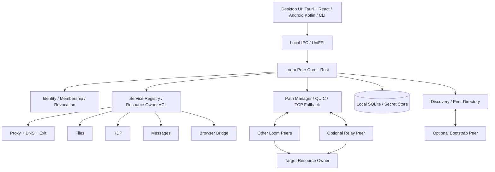
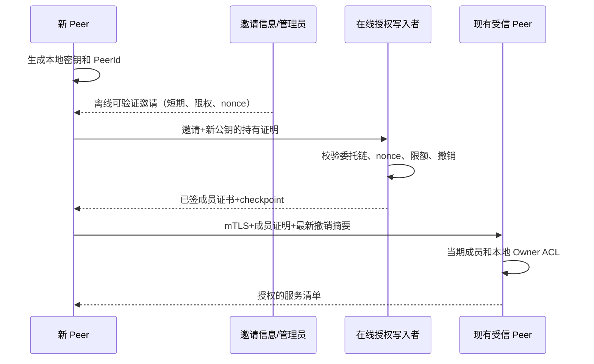
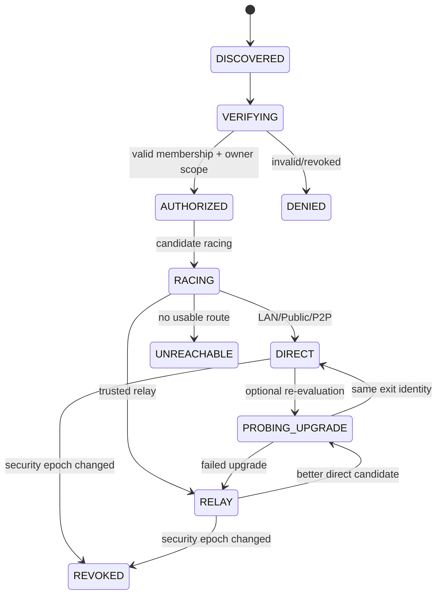
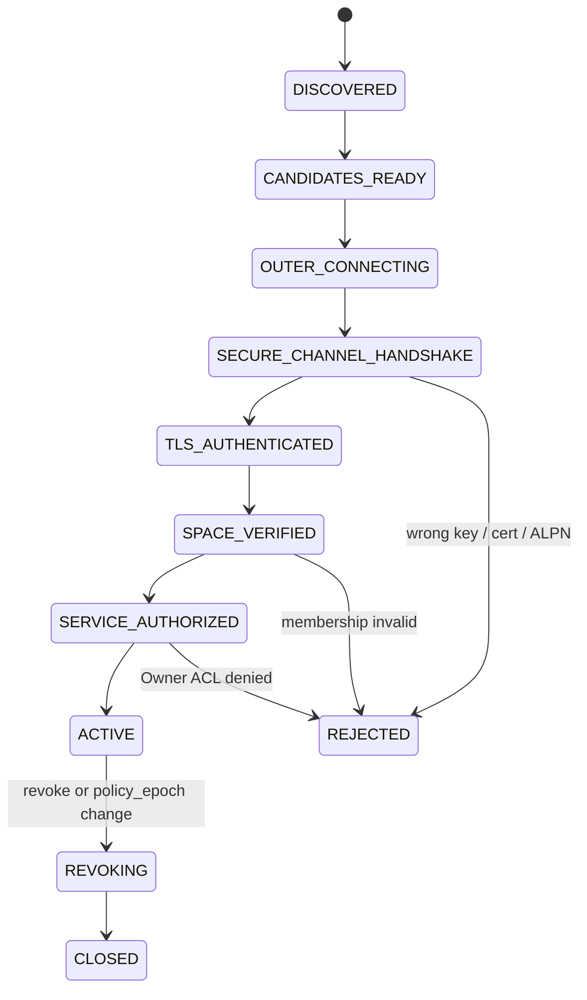
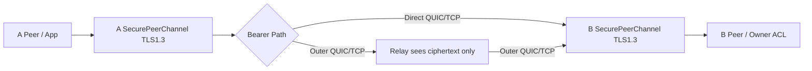

# Loom：RelayProxy Rust 全量重构与去中心化 Peer Mesh 完整设计

> 版本：v1.1 / 评审整改版（安全规范候选，尚未冻结）  
> 日期：2026-10-17  
> 目标仓库：[`timwai/Loom`](https://github.com/timwai/Loom)  
> 现有产品：[`timwai/RelayProxy`](https://github.com/timwai/RelayProxy)  
> 参考源码基线：RelayProxy `main@e4254c81ed678198c948272c22981fd16c19be9a`  
> 参考设计：`design/decentralized-peer-mesh/docs/relayproxy-decentralized-peer-mesh-design.md` v1.2，以及 `mesh-server-dependency-inventory.md`、`mesh-authz-lifecycle-review.md`  
> **仓库事实**：经 GitHub 仓库元数据和 Git Ref/Tree API 确认，Loom 当前是空 Git 仓库，`main` 尚无初始化 commit（GitHub 返回 `409 Git Repository is empty`）。以下均为**新架构建议**，不是现有 Loom 代码能力。  
> **文档用途**：技术评审、任务拆分、实施及验收。除非明确批准，不应将“设计拟定”视为“已实现/已验证/已兼容”。


> **v1.1 修订说明**：本版依据《Loom Rust Peer Mesh v1.0 独立架构设计评审》（LOOM-R01～R21：8 P0 / 9 P1 / 4 P2）修订。在原 31 章基础上将必要的协议选择、错误状态、权限屏障、离线恢复、平台 Spike 和阶段门禁写入对应章节；新增 L-ADR-19～L-ADR-23。原提案里与新增「v1.1 规范」冲突的示例，以 v1.1 规范为准。**所有 ADR 当前状态均为 DESIGN_DRAFT 或 SPIKE_REQUIRED，不代表已实现、经过第三方审计或经跨语言验收冻结**。

> **来源划分**：原版对 RelayProxy 源码的描述属于之前已核实的静态审查；本次 v1.1 的协议字段、阈值、接口及实现取舍属于**新提出的设计要求**。未执行 Rust 编译、跨平台 PoC、网络实测。原版文档不被覆盖，可用于对照修改。 

---

## 0. 执行决策

**总方案**：在 Loom 中以 Rust Cargo Workspace 从零建设一个统一的 `loom-core`；Windows/macOS/Linux 共享 Rust 守护进程、服务和网络引擎，桌面界面采用 Tauri 2 + React/TypeScript；Android 保留 Kotlin 原生 UI/VpnService，调用 UniFFI 导出的 Rust 核心；iOS 可选 SwiftUI/NetworkExtension。浏览器扩展保留 TypeScript（浏览器 API 本身不支持“纯 Rust 替代”）。

**产品语义**：每个设备只有 Peer 身份，没有永久 Server/Agent 标签；Client、Exit、Relay、Discovery、Bootstrap、FileHost、RDPHost、MessageSink 等是可配置、可撤销、受平台限制的服务能力。公网上可常驻的 VPS 仅是配置了 Bootstrap/Relay 的一个 Peer，不是身份授权中心。

**重构方式**：采用新产品、新协议、新存储模型；用旧 RelayProxy 作为**黄金行为基线**和可选择的迁移来源。不得承诺 Rust Loom 无桥接即可连接现有 Go Server/Agent。旧版本继续独立运行，直到功能对照、授权映射、测试通过。

**安全原则**：资源 Owner 最终授权；成员凭证和资源 Grant 双向验证；撤销优先；安全状态未知时对新高风险操作拒绝；多身份空间严格隔离；中继无权代替目标 Peer 决策；文件目录未授权不可见；进程重启和备份回滚不复活权限；旧/新双协议期间执行 `LegacyAllow ∧ LoomAllow`。

**关键工程约束**：Rust 可以降低内存安全风险，但不自动解决 NAT、DNS 归因、操作系统透明代理、跨语言协议、QUIC 拥塞和分布式撤销。所有相关结果必须基于测试，不做性能超越的预设。

### 0.1 架构图



### 0.2 决策状态一览

| ID | 议题 | 推荐方向 | 状态与门禁 |
| --- | --- | --- | --- |
| L-ADR-01 | 新项目与 Rust 适用范围 | Loom 独立 Cargo workspace；Rust 业务内核，OS/API 适配保留原生语言 | 建议批准 |
| L-ADR-02 | 节点模型 | 单一 Peer Core + 可启停服务；不建中央 Server | 建议批准 |
| L-ADR-03 | Runtime | Tokio 单运行时，结构化任务与有界队列 | 建议批准 |
| L-ADR-04 | QUIC | Quinn + rustls，先验证 CUBIC，评估 BBR/自研 CC | API 样例验证后批准 |
| L-ADR-05 | 身份 | 独立 Ed25519 设备钥，空间根/委托授权、mTLS 绑定 | 威胁模型及向量批准后冻结 |
| L-ADR-06 | 管理事件 | 每授权 Scope 单写者哈希链 + 仅撤销事件 overlay | 回滚/分区/快照负向测试 |
| L-ADR-07 | Wire | 控制面 prost/protobuf；**安全事件候选：受限 RFC 8949 确定性 CBOR + Ed25519**（详见 §10.5） | P0 Rust/Go/Kotlin/JS 测试向量通过后才可冻结 |
| L-ADR-08 | Storage | rusqlite + 单写者 actor + WAL + 密钥存 OS 安全区 | 并发/崩溃/迁移测试 |
| L-ADR-09 | 发现 | LAN + 静态节点 + 可选 Bootstrap；不做全球 DHT | 隐私与 NAT 测试 |
| L-ADR-10 | Relay | 默认关闭、受信单跳、预认证；**底层两段 TLS 不等于 E2EE**，须 L-ADR-19 通过 | 恶意 Relay 明文/替换/降级测试 |
| L-ADR-11 | GUI | Tauri 2 + React 设备导向 UI；Android 原生 | 启动/托盘/性能/原生交互 POC |
| L-ADR-12 | 平台插件 | OS 网络权限留在隔离 adapter/helper，不污染 Core | 驱动/签名/FFI 故障测试 |
| L-ADR-13 | 兼容 | 默认全新 Loom Mesh，显式迁移及可选 Legacy Bridge | 不自动导入旧设备信任 |
| L-ADR-14 | 协议版本 | Loom/1 独立 ALPN 与 framing，不冒充 RelayProxy 旧版本 | Fuzz 与兼容测试 |
| L-ADR-15 | 授权新鲜度 | Owner 本地 epoch 与持久撤销 + 会话切断屏障 | P0 安全关键 |
| L-ADR-16 | 性能 | 旧 Go vs 新 Rust 同环境实测，按功能/尾延迟比较 | 不设置未经测量的绝对超越承诺 |

### 0.3 v1.1 架构裁决摘要与 ADR 状态

| ADR | 本轮明确的候选决策 | 是否可进入生产实现 |
|---|---|---|
| L-ADR-19 | 所有底层路径以承载字节流方式接入统一 `SecurePeerChannel`；**内层 TLS 1.3 双向 Peer 认证**独立于外层 QUIC/TLS | **否**，先验恶意中继与多流复用 PoC |
| L-ADR-20 | Owner 本地 `AdmissionBarrier` 保护 `(space_id,resource_id)`；DB policy epoch/outbox/会话标记按屏障串行 | **否**，先验崩溃与竞态 |
| L-ADR-21 | SQLite 快照不构成新鲜度证明；使用独立 high-water 见证/外置锚，证据不足 `POLICY_STALE/SAFE_READONLY` | **否**，先验回滚和离线恢复 |
| L-ADR-22 | LocalUser + SpaceRole + ResourceOwner + OS privilege 分别鉴权；GUI/WebView 无隐含管理员能力 | **否**，先验本地攻击测试 |
| L-ADR-23 | Android/Windows/macOS 的最小系统网络能力必须在 P0 Spike 验证 | **否**，先验真实平台 |
| L-ADR-07 | protobuf 用于非签名控制消息，安全事件本体使用受限确定性 CBOR 候选 | **否**，跨语言 golden vectors 未跑 |

**架构 Go/No-Go**：允许建 Cargo 工作区、编写领域 trait、无默认启用的实验协议和平台验证；严禁把「可设计」写成「已完成 E2EE／已安全撤销／已替代 RelayProxy」。

## 1. 产品目标、成功标准与非目标

### 1.1 MUST

1. 对普通用户，连接设备无需理解 Server/Agent；每台设备按权限共享服务。
2. 没有云端必需账户、中央批准服务器和固定主节点；两台受信设备能在局域网离线互通。
3. WAN 首选真实公网 QUIC 或可行的 NAT P2P，失败时选授权 Relay 或清楚报错。
4. 现有产品功能逐项具备可替代路径：SOCKS5/HTTP/透明代理、DNS 分流、出口规则、P2P、RDP、共享文件、浏览器功能、消息、订阅与审计。
5. 文件共享读写分级、目录不泄漏、原名下载、续传、进度、拖拽和右键操作。
6. 授权撤销、离线、回滚、重启、密钥轮换均 fail-closed；无权限的 Peer 不得通过 Relay 绕过 Owner。
7. Windows/macOS/Linux 可 Headless 运行；UI 可退出且 daemon 按设置留后台；Android VpnService 受系统生命周期管理。
8. 安全/配置/控制面统一，所有客户端有同一协议、错误语义与版本协商。
9. 不强制开发者账户才能在 Windows/Linux 或普通 Linux VPS 运行基础代理；Apple 系统级 NetworkExtension 功能明确受签名及 entitlement 约束。
10. 具备可复现构建、跨平台签名向量、自动化故障注入、72 小时稳定性验收。

### 1.2 非目标（首版）

- 公网匿名开放代理、商业多租户计费云、全球 Kademlia DHT、区块链或多写者通用 CRDT 共识。
- 依赖单台 Relay 自动解决所有严格 NAT / UDP 禁止环境；没有可达 Relay 时允许明确失败。
- 用 Rust 重写操作系统内核驱动、Android VpnService Java 系统 API 或 Chrome 扩展 API。
- 保障 Cookie/IndexedDB 同步必然维持网站登录状态；服务端设备绑定、WebAuthn、MFA 等不可绕过。
- 在 Windows/macOS/Android/iOS 上许诺透明代理有完全相同的进程识别能力。
- 一次上线前强迫所有旧 RelayProxy 节点升级。

## 2. 现有 RelayProxy 的可验证基线

仓库 `main@e4254c81...` 包含：`cmd/relay-server`、`cmd/relay-agent`、`server/repository`、`server/gateway`、`server/p2p`、`server/direct`、`agent/app`、`agent/direct`、`agent/fileshare`、`agent/divert`、`internal/tunnel`、`internal/acl`、`browser/chrome-extension`、`android/app` 等，当前 Go `go.mod` 使用 `github.com/apernet/quic-go` 的 fork、Wails v3、SQLite 等。此项目可以用来生成**行为对照**，而非直接移植内部结构。

现有已核实集中依赖如下：

| 现有路径 | 已核实的角色 | Loom 内替代 |
| --- | --- | --- |
| `server/repository/identity_grant.go` | 同身份/跨身份授权、policy revision、Grant 状态 | `loom-policy` + Owner signed grant ledger |
| `server/session/manager.go` | 授权变更与设备注册串行化；会话失效 | `loom-session` + policy epoch admission barrier |
| `server/p2p/coordinator.go` | SessionToken、lease、候选交换、授权回查 | `loom-signaling` + Owner admission |
| `server/direct/ticket.go`、`agent/direct/ticket_auth.go` | 签名 Direct ticket、当前授权回查和 replay | Owner 短期能力票据 + Owner 当前状态核验 |
| `server/gateway/fileshare.go` | 授权文件设备目录、Host 确认可见与二次检查 | `loom-files` Host 私有可见性判定 |
| `server/rdp/coordinator.go` | 控制器授权/lease/目标联机 | `loom-rdp` + Owner RDP admission |
| `server/browser_sync/` | 扩展授权、WSS、会话规则/递增序列 | `loom-browser-bridge` + 插件直连/本地桥 |
| `agent/exit/handler.go` 和 `internal/acl` | 目标域名及解析后 IP 二次 ACL | `loom-proxy` + `loom-policy` 双阶段拦截 |
| `internal/tunnel/session.go` | 传输多路复用接口 | `loom-transport`；不机械复制 Go 类型 |

**发现并须保留的安全约束**：Grant 先写 DB 再回调让在线会话失效存在时序分离，设备撤销另有锁串行化；Loom 需要**事务写入 epoch + 可靠 outbox + admission barrier + 活动会话关闭**，不能只做签名验真。现有 P0 源码评审并未完成全仓 AST 调用图和动态性能采样，不能据其入边数估算人天。

## 3. 统一 Peer Core：抽象边界

### 3.1 每台设备的逻辑层

```text
┌──────────────────────────────────────────────────────────┐
│        Platform Shell / UI / CLI / Browser Bridge         │
├───────────────────────────── Local IPC ───────────────────┤
│  Loom Runtime / Settings / EventBus / Health / Scheduler  │
├──────────┬───────────┬───────────┬───────────────────────┤
│ Trust &  │ Discovery │ Sessions  │ Local Owner Services  │
│ Policy   │ & Paths   │ & Streams │ Proxy File RDP Msg ...│
├──────────┴───────────┴───────────┴───────────────────────┤
│  QUIC / TLS fallback / UDP sockets / Crypto / SQLite      │
├──────────────────────────────────────────────────────────┤
│          Host OS interfaces / Secure key store            │
└──────────────────────────────────────────────────────────┘
```

### 3.2 角色定义

`PeerRole` 不存为互斥枚举；角色由可验证的 `ServiceDescriptor` 集合推导：`proxy.client`、`proxy.exit`、`relay.forward`、`peer.discovery`、`files.host`、`files.client`、`rdp.host`、`rdp.client`、`browser.bridge`、`message.sink`、`audit.mirror`。服务开关和**为谁开放**完全独立；开启服务≠全网公开。

每个设备可以开多个角色，能力随电源、网络和用户授权动态变化。Android 默认 Client 而不是永远在线 Relay；VPS 默认可承载 Bootstrap/Relay，仍必须显式启用。

### 3.3 所有 Peer 必需能力

- 加载自己的设备密钥并建立加密 Peer 会话；处理至少一个身份空间。
- 验证签名成员凭证与资源 Grant；保留撤销及 checkpoint 反回滚状态。
- 能发起连接、处理本地服务 RPC；默认保护本地 API。
- 有界本地存储和健康检查；能生成最小诊断。

可选模块必须通过 trait/feature flag 隔离，不因 Android 无 RDP Host 而无法编译核心。

## 4. Rust Workspace 推荐结构

```text
Loom/
  Cargo.toml                # [workspace], resolver=3, profiles, lints
  Cargo.lock                # application repo 锁定版本
  rust-toolchain.toml        # pin verified toolchain; no unstable nightly dependency
  deny.toml                 # licenses/advisories policy
  crates/
    loom-types/              # PeerId/SpaceId/ResourceId/typed errors
    loom-crypto/             # key provider, sign/verify, transcript, AEAD
    loom-wire/               # protobuf / framing / golden vectors
    loom-identity/           # device identity, enrollment, membership
    loom-policy/             # Owner ACL, grants, revocation, epoch barrier
    loom-ledger/             # signed chain, checkpoint, outbox, GC
    loom-store/              # rusqlite + migrations + backup
    loom-discovery/          # LAN discovery, bootstrap, address hints
    loom-nat/                # STUN probes, IPv4/IPv6, UPnP PCP NAT-PMP opt-in
    loom-transport/          # Quinn, TLS fallback, stream session
    loom-path/               # racing, failure budget, path selection
    loom-relay/              # relay admission, quotas, counters, fairness
    loom-signaling/          # rendezvous, candidate exchange, leases
    loom-service/            # service advertisements and registry
    loom-proxy/              # SOCKS5/HTTP, DNS, routing, Exit, ACL
    loom-files/              # share grants, list/upload/download/resume
    loom-rdp/                # RDP bridge and ingress policy
    loom-browser-bridge/     # browser local bridge + encrypted envelopes
    loom-message/            # channels, rule engine, notification
    loom-audit/              # connection audit, geoIP, bans
    loom-subscription/       # route/ads subscriptions and compiler
    loom-observe/            # metrics, tracing, diagnostic report
    loom-core/               # orchestration and service lifecycle
    loom-local-api/          # Unix socket / named pipe JSON-RPC, events
    loom-ffi/                # UniFFI / thin C ABI only
    loom-platform/           # platform traits and shared abstractions
    loom-platform-win/       # WinDivert, process attribution, service
    loom-platform-macos/     # NE bridge, keychain, launchd
    loom-platform-linux/     # TUN / nftables/iptables adapter, systemd
    loom-platform-android/   # TUN fd, protect(), lifecycle JNI
  apps/
    loomd/                  # headless CLI/daemon (Rust)
    loomctl/                # control CLI (Rust)
    desktop/                # Tauri 2 + React/TypeScript
    android/                # Kotlin/Compose + Rust .so
    ios/                    # optional SwiftUI + Rust XCFramework
    browser-extension/      # Chrome MV3 / TypeScript
  proto/loom/v1/           # protocol .proto source of truth
  api/openapi/             # local API schemas (generated)
  test-vectors/            # crypto/wire/golden cases
  tests/e2e/               # multi-node tests, NAT fault matrix
  benches/                # latency/bandwidth baseline harness
  fixtures/legacy/        # sanitized old Go protocol/config/db fixtures
  docs/adr/               # numbered, accepted ADRs
  docs/spec/              # trust/wire/storage/network/features
  scripts/ci/             # reproducible build and verify
  packaging/              # per-platform signed artifacts
```

**避免 30+ crates 第一日全部创建**：P0 先落地 8 个骨架（types/crypto/wire/identity/policy/store/transport/core），业务按垂直功能逐步抽出。crate 边界以协议/所有权为主，防止大量循环依赖和泛型传播。

### 4.1 依赖方向规则

`types,crypto,wire` → `identity,store,policy,ledger` → `transport,discovery,path,relay` → `service,proxy,files,rdp,...` → `core` → `local-api/FFI/daemon/UI`。业务模块只经 `PolicyEngine` trait 依赖鉴权，不直接读其他模块 SQLite 表；任何跨模块 SQL 写入都必须经有明确所有权的事务服务。

## 5. Rust 实施纪律

- Tokio：单个 Peer Core 管理 runtime；不在 FFI 回调和 GUI 主线程上运行阻塞 I/O。SQLite 用专有 DB actor/`spawn_blocking`，避免持有非 `Send` `rusqlite::Connection` 跨 `await`。
- 所有后台任务关联 `CancellationToken` + `JoinSet` 和关闭截止期限；任务泄漏视为测试失败。
- 全链路有界 channel/队列、单 Peer 每秒消息数、单流/单连接内存限额；数据队列背压不能堵 P0 revoke 控制流。
- 使用 `Bytes`/`BytesMut`、读写 buffer 池；禁止无限制 `read_to_end` 处理远端输入。长度限制先于反序列化与解压。
- 将 Peer/Space/Resource 标识包装成不同 Rust newtype；身份/策略上下文不可用裸字符串自动互换。
- 不将 `unsafe` 扩散到核心：WinDivert、JNI、Objective-C/C 系统调用局限在独立包并审查内存所有权。
- 自有日志不得输出 Cookie、私钥、Grant 原文、session token、敏感 URL 参数；按字段脱敏。
- `thiserror` 声明库内部错误，稳定 `ErrorCode` 映射为本地 API/协议错误；不得暴露不稳定 debug stack 到远端。
- dependencies 受 `cargo deny`、SBOM、锁文件、license policy 和供应链签名限制；生产构建固定最低工具链 + 编译 profile。

## 6. Rust 领域接口（概念 API）

```rust
#[derive(Clone, Debug, PartialEq, Eq, Hash)]
pub struct PeerId(pub [u8; 32]);
#[derive(Clone, Debug, PartialEq, Eq, Hash)]
pub struct SpaceId(pub [u8; 32]);
#[derive(Clone, Debug, PartialEq, Eq, Hash)]
pub struct ResourceId(pub [u8; 32]);

pub struct Principal {
    pub peer_id: PeerId,
    pub space_id: SpaceId,
    pub key_epoch: u64,
    pub membership_epoch: u64,
}

#[async_trait::async_trait]
pub trait OwnerAuthorizer: Send + Sync {
    async fn authorize(&self, principal: &Principal,
        resource: &ResourceId, action: Action,
        proof: &[u8]) -> Result<Permit, AuthError>;
}

#[async_trait::async_trait]
pub trait PeerDialer: Send + Sync {
    async fn connect(&self, space: &SpaceId, target: &PeerId)
        -> Result<AuthenticatedPeerConnection, TransportError>;
}

#[async_trait::async_trait]
pub trait ServiceProvider: Send + Sync {
    fn descriptor(&self) -> ServiceDescriptor;
    async fn handle(&self, ctx: AuthorizedStreamContext,
        stream: Box<dyn LoomStream>) -> Result<(), ServiceError>;
}
```

**类型安全不代替授权**：`AuthenticatedPeerConnection` 只说明远端身份在某条路径上被验证，业务流必须再次按 `space_id/resource_id/action/current_policy_epoch` 授权。`AuthorizedStreamContext` 只能由受信的 `AdmissionService` 构造，不能由网络包字段反序列化构造。

## 7. 设备身份、Space、加入和恢复

### 7.1 标识与信任锚

- 设备有独立安装密钥 `DeviceKeyPair (Ed25519)`；私钥在 OS secure store，或经本机保护的加密文件；支持导出受密码保护的灾难恢复包但默认不导出原始设备私钥。
- `PeerId = SHA-256(domain || device_public_key)`，具体 domain、序列化和编码在 P0 冻结；设备改钥生成新的身份绑定 epoch，并验证旧→新签名或走新邀请。
- `SpaceId` 基于空间 Genesis Document / Root 公钥派生，不直接继承旧 RelayProxy 公开身份短 ID。
- 每个空间有 Root 管理、单写者成员链、可限权管理员委托、Owner 自己签发资源授权。
- 同一 Peer 可加入多个 Space，但状态、成员目录、候选端点、Gossip、Relay 配额、审计标签、Browser 订阅全部分区；连接复用不得复用授权上下文。

### 7.2 加入流程



邀请创建者可以离线；由有正确授权权利的其他在线写入者受理。无合格在线写入者时只能显示 `PENDING`，不能以邀请存在为由先行授予成员权限。邀请有 `space_id, intended_role, issuer_key_id, audience, max_uses, expires_at, nonce, signature`，兑换状态需要链上持久记录以防多点重放。

### 7.3 密钥丢失与紧急撤销

- 本机签名密钥丢失：不能凭旧设备名称或旧公开 ID 自动重新绑定；必须重新加入并在 UI 显示旧设备已失联/需撤销。
- Root 长期离线：受限授权的 `EmergencyRevoker` 可只减权撤销被盗管理员和设备，不得创建新成员/扩大 Grant。
- 失窃管理员：带签名 revoke-only 事件独立传播，并且在合并时单调胜出；Root 恢复后发布新 writer epoch 和签名恢复 checkpoint。
- 防回滚：持久化已观察最大 writer epoch、chain head、revocation root、key epoch；恢复旧备份后不能重新认可过期授权；如果无法验证，进入 `POLICY_STALE/SAFE_READONLY`。

### 7.4 v1.1 权限凭证、轮换与恢复的可执行模型（R05）

V1 明确三种互不等价的签名权限：`SpaceRoot`（离线根信任与灾难恢复）、`MembershipWriter`（按 `space_id + writer_epoch` 串行签发/更新成员凭证）、`EmergencyRevoker`（仅在委托覆盖的 scope 内生成**只减权**撤销证据）。其中 `ResourceOwner` 是**资源授权独立权威**，不是第四种可代理空间成员扩权的管理员。

| 操作 | Root | 当前 Writer | 委托 Revoker | Resource Owner |
|---|---|---|---|---|
| 创建空间、根恢复和合法 Writer epoch 轮换 | 允许 | 禁止（除非由根签发特定继任授权） | 禁止 | 禁止 |
| 签发/更新空间成员凭证 | 可签发 Writer 委托；正常成员写由 Writer 串行 | 允许，必须在委托 scope/期限内 | 禁止 | 禁止 |
| 紧急撤销设备、成员或密钥 epoch | 允许 | 仅显式拥有相应 revoke 权时 | 允许，仅针对 delegated scope | 仅可撤销自己资源的 Grant |
| 扩大 `ResourceGrant` | 不自动拥有资源所有权 | 禁止 | 禁止 | 允许；须签名 OwnerPolicyCommit |
| 创建/兑换邀请 | 签委托 | 签邀请、入链确认 | 禁止签发授权 | 可发资源邀请，但不能入空间成员链 |
| 删除或“反撤销”旧 revoke 证据 | 禁止 | 禁止 | 禁止 | 禁止 |

**规范字段草案**：`DelegationV1 {space_id, issuer_key_id, subject_key_id, role, scope_patterns, action_mask, valid_from, valid_until, delegation_epoch, parent_hash, signature}`；`MemberGrantV1 {space_id, device_id, peer_id, key_epoch, member_epoch, writer_epoch, permissions, expires_at, seq, prev_hash, signature}`；`RevocationV1 {space_id, target_kind, target_id, target_key_epoch, revoker_key_id, delegation_hash, seq_or_nonce, issued_at, reason_code, signature}`。键 ID 是域分离公钥指纹；签名均遵守 §10.5 受限确定性 CBOR。**角色和范围比 UI 展示名优先**。

- **最大有效期初始上限（待安全审查校准）**：Writer 委托 30 天、Revoker 委托 7 天、成员授权 7 天、高风险会话 Capability 不超过 5 分钟；这些不是跨网络即时撤销的承诺。离线根可预设后备 Writer 但同一空间同一 `writer_epoch` **仅承认一个有序写入者**。
- Writer 轮换通过 Root 授权的 `WriterEpochAdvance`，带旧 head/签名与新 key，检测相同 `(space,epoch,seq,prev_hash)` 双签时存 `EquivocationProof` 并**冻结该链继续扩权**。
- 多个有效 EmergencyRevoker 产生的撤销证据为**单调并集**，不可被旧 grant 覆盖。恶意 Revoker 可造成拒绝服务，这是设计接受的可用性风险；根管理员须轮换恶意委托并发行**新 epoch + 新凭证**恢复合法成员，而不是删除历史 revoke。Root 不可用且现存凭证失效时进入 `SAFE_READONLY` 或需重新建空间。
- 邀请签名独立校验、新公钥 pin、single-use nonce；任何在线 Peer 可转发兑换请求，**只有当前 Writer** 能把成员签发入链；并发兑换保持幂等并拒绝用旧 nonce 扩权。
- 设备身份稳定 ID 与密钥 epoch 明确分离，轮换必须同时证明旧持有权（可用时）及 Root/Writer 授权；丢失旧私钥不复用旧 PeerId，按新设备邀请处理。

### 7.5 v1.1 防回滚的独立信任锚（R04）

**SQLite WAL、签名 checkpoint、本机 Keychain/Keystore 本身均不能证明“这是最新已知撤销状态”。** 引入 `AnchorProvider` 取以下任一受审核模式：

1. **可达可信见证**：两台预登记、互不依赖的见证 Peer 对 `(space_id, chain_id, writer_epoch, seq, head_hash, revocation_root, issued_at)` 签发 `CheckpointWitness`；Owner 验签并比较本地高水位；见证只证明各自已观察状态，不假设它们能代表全网真相。
2. **平台独立保护锚**：与 SQLite 备份独立、实际具备回滚抗性的安全计数器或受信状态存储；必须在平台 Spike 证明安全特性，**不能仅凭使用 Keychain/Keystore 就声称防回滚**。
3. **可验证的既有本地根**：本地持有上次已验证的高水位并确保本地攻击模型不允许回滚该锚。对于用户主动恢复整机镜像，不能单靠它通过安全门禁。

`AnchorRecordV1` 必须包含单调版本、Space/chain、writer epoch、head、revocation accumulator/root、可信见证 key 列表、证据取得时间与签名。合并原则为**最大已观察版本 / 撤销集合不可回退**；出现同 epoch 双 head 进入 `SYNC_CONFLICT`。高风险资源的新准入在无法证明新鲜度时拒绝，已存在安全会话只允许文档定义的最短有限宽限；离线多久能继续使用由资源级 `freshness_budget` 决定，而不是假设能从单个 Bootstrap 查询到最新撤销。

**恢复状态机**：`BOOTSTRAP_RECOVERY → VERIFY_LOCAL_ANCHOR → FETCH_WITNESSES → VERIFY_CHECKPOINT_AND_REVOCATIONS → READY`；任何不可确认的 downgrade 转 `POLICY_STALE`，疑似旧备份或锚冲突转 `SAFE_READONLY`。Root 只能在新 epoch 进行显式灾难恢复，**不能允许旧事件复活已撤销授权**。

## 8. 资源授权和撤销（必须优先完成）

### 8.1 授权判定

```
EffectiveAllow =
    TransportIdentityValid
 ∧  SpaceMembershipCurrent
 ∧  DeviceCapabilityApproved
 ∧  ResourceOwnerGrantCurrent
 ∧  ResourceOperationAllowed
 ∧  TargetACLAllows
 ∧  RevocationCheckFresh
 ∧  LocalSecurityStateHealthy
 ∧  (LegacyAllow if legacy-bridge dual-enforcement)
```

- 无服务能力不等于有访问权；本地代理客户端能力、远端出口服务开启、远端资源 Owner Grant、目标 ACL 是不同概念。
- Grant 字段：`grant_id, space_id, resource_owner, resource_id, subject_peer_id, actions, constraints, issued_seq, expires_at, policy_epoch, writer_key_id, signature`；原则上不支持跨 Space 的隐式身份继承。
- **最敏感资源**（私网出口、文件写入、RDP Host、消息管理、认证管理）优先显式授予，老用户迁移时按 LegacyAllow 约束保留已允许集合。
- Owner 只有自己能够提交资源 ACL；管理员可提议/暂停，由 Owner 决定最终授予。例外：经过预先签名的紧急仅撤销委托。

### 8.2 原子授权屏障

SQLite 授权更改的一次提交中必须同时写：

1. 新 `policy_epoch`（单调递增）；
2. 签名 Grant/Revoke 安全事件与 outbox 任务；
3. 需要关闭的 session selector 和审计记录。

**提交后立即**改变本机 admission 使用的 epoch（内存状态不得落后持久化真相）；仍持有旧 epoch 的 `SessionOpen` 一律拒绝。已有流在过渡状态 `REVOKING` 后中断；若出站通知失败，持久 outbox 重试，目标 Owner 本地仍不能放过新流。避免“DB commit 成功但回调失败仍持续授权”。

### 8.3 离线与新鲜度

- 分布式网络无法同时保证分区下撤销立即传播与全网继续放行。已收到撤销的 Owner 立即执行；未收到撤销且证明过旧时，按动作风险阻止新连接，不能声称全网 5 秒强保证。
- 委托凭证、服务能力票据上限可按风险分类；默认候选 5 分钟，但不是自动允许旧权限 5 分钟。Owner 当前撤销根和 policy epoch 永远优先。
- 设备时钟跳变：监测单调时钟 vs 墙钟以及已知 Peer 时间观测；异常进入 `POLICY_STALE`，阻止新的高敏操作。容忍阈值是待冻结参数，不能盲目放宽为 5 分钟。
- `SECURITY_EVENT` P0 专用可靠队列优先处理 `member.revoke/grant.revoke/key.revoke/root.rotate`，持久化并验签后 ACK；控制拥塞不得用大文件覆盖该队列。

### 8.4 v1.1 授权提交屏障的唯一准入顺序（R02 / L-ADR-20）

**原 §8.2 的“DB commit 后立即更新内存 epoch”不是完整原子协议，以下步骤覆盖该简写**：

1. 对 `(space_id, resource_id)` 取得**异步排他 admission gate**；`SessionOpen` 在入 gate 后还要读取持久化的最新 `policy_epoch`，禁止先用缓存放行再检查。单独的 `SpaceMemberRevoked` 必须对受影响资源批量封锁入口；锁获取顺序固定 Space → Resource → Session，防死锁。
2. DB actor 在一个 `BEGIN IMMEDIATE` 事务中验证旧 epoch、提交新的签名策略事件/撤销证据、`policy_epoch = old + 1`、新增持久 `critical outbox`、记录 affected session selector/audit；**先写 outbox 再 COMMIT**。所有更新依赖同一事务结果。
3. 事务成功后、**仍持 gate** 时发布新内存版本、设置受影响活动会话的 `CancellationToken` 并变更 `revoking=true`；新准入再次校验 `policy_epoch` 和 revoke set。只有这些同步状态生效才能解除 gate；实际 socket close/网络推送可异步进行。
4. `COMMIT` 返回不确定、DB 查询失败、更新缓存失败、进程在边界崩溃时，该资源处于 `ADMISSION_PAUSED`，恢复流程重新读取 DB 并重建 session table 和 outbox；**不能返回旧 allow**。
5. Peer 启动时顺序为：密钥/锚验证 → DB 完整性校验 → replay 撤销/恢复 outbox → 重建 epoch/admission gates → 建立可观察状态 → 最后开放业务 listener。没有可信锚的资源保持锁定。

**准入不变量**：对 owner 本地某资源，`Commit(policy_epoch=N)` 之后任何成功返回的 `SessionOpen` 必须绑定 `AuthorizedEpoch ≥ N`；在提交并发中，要么操作先于撤销并在限制时间内被取消，要么在撤销后拒绝；不得让 commit 之后读旧缓存建立新的高危会话。应通过 loom-store/loom-policy 的 loom-tests `loom::authz::race` 覆盖所有交错。

**活动流终止（初始 SLO 目标，须实测校准）**：新 SessionOpen 在策略本地提交后立即拒绝；文件写/RDP 控制/私网出口有新数据时必须检查 CancellationToken，目标进程内 1 秒内停止发送新业务数据，p99 2 秒内完成主动关闭；文件只读/长下载可定义不超过 5 秒的关闭预算但不可扩权。进程崩溃后旧会话不可恢复为获授权。远端分区接收撤销时间无法被这个本地 SLO 保证。

**Rust 参考契约（伪代码，异步锁与 DB actor 之间禁止跨 await 持有阻塞 SQLite 锁）：**

```rust
pub struct AuthorizedEpoch { pub epoch: u64, pub revocation_root: [u8; 32] }
pub struct AdmissionPermit {
    pub principal: Principal,
    pub resource_id: ResourceId,
    pub epoch: AuthorizedEpoch,
    pub cancelled: tokio_util::sync::CancellationToken,
}
pub enum AdmissionState { Ready, Paused, PolicyStale, SafeReadonly }

pub trait AuthorizationCoordinator: Send + Sync {
    // The only issuer of AdmissionPermit: network/user inputs never construct it.
    async fn open(&self, req: ServiceOpenRequest) -> Result<AdmissionPermit, AuthError>;
    async fn apply_owner_event(&self, event: SignedOwnerEvent) -> Result<u64, AuthError>;
}
```

**持久化边界**：`policy_epoch`、`signed_events`、`critical_outbox`、`revocation_evidence` 在单事务；底层证据见证独立于 SQLite，按 §7.5 验证。不可跨进程把 `CancellationToken` 当成持久化撤销证据。

## 9. 事件链、一致性与存储

### 9.1 V1 状态模型

- 成员/空间配置：一个授权 Writer 的严格 seq + prev_hash 链；writer epoch 轮换须 root/delegation 证明。
- 资源 Owner ACL：每 Owner/Resource 一个签名写入序列。不同 Owner 之间无需全局线性共识。
- 紧急撤销：只减权、可独立到达的签名事件集合；合并采用撤销优先，永不被迟到的旧 Allow 覆盖。
- 冲突：签发者相同 seq/prev hash 却签两个不同 payload 生成 `EquivocationProof`，冻结该写入者扩权，进入恢复流程。
- 落后节点：持久 cursor + snapshot/checkpoint+delta；未知 parents 进入容量有限的 orphan queue，不能先执行授权。

### 9.2 SQLite 草案

```sql
PRAGMA journal_mode=WAL;
PRAGMA foreign_keys=ON;

CREATE TABLE peer_identity (
  peer_id BLOB PRIMARY KEY,
  key_epoch INTEGER NOT NULL,
  public_key BLOB NOT NULL,
  created_at_ms INTEGER NOT NULL
);
CREATE TABLE spaces (
  space_id BLOB PRIMARY KEY,
  genesis_hash BLOB NOT NULL,
  writer_epoch INTEGER NOT NULL,
  highest_observed_seq INTEGER NOT NULL DEFAULT 0,
  trust_state TEXT NOT NULL
);
CREATE TABLE members (
  space_id BLOB NOT NULL,
  peer_id BLOB NOT NULL,
  membership_epoch INTEGER NOT NULL,
  roles BLOB NOT NULL,
  expires_at_ms INTEGER,
  revoked INTEGER NOT NULL DEFAULT 0,
  PRIMARY KEY (space_id, peer_id),
  FOREIGN KEY(space_id) REFERENCES spaces(space_id)
);
CREATE TABLE signed_events (
  event_id BLOB PRIMARY KEY,
  space_id BLOB NOT NULL,
  chain_id BLOB NOT NULL,
  writer_epoch INTEGER NOT NULL,
  actor_seq INTEGER NOT NULL,
  prev_hash BLOB,
  kind TEXT NOT NULL,
  canonical_bytes BLOB NOT NULL,
  signature BLOB NOT NULL,
  issued_at_ms INTEGER NOT NULL,
  UNIQUE(space_id, chain_id, writer_epoch, actor_seq)
);
CREATE INDEX idx_events_chain ON signed_events(space_id,chain_id,writer_epoch,actor_seq);
CREATE TABLE revocations (
  space_id BLOB NOT NULL,
  target_type TEXT NOT NULL,
  target_id BLOB NOT NULL,
  event_id BLOB NOT NULL,
  revoked_at_ms INTEGER NOT NULL,
  PRIMARY KEY(space_id,target_type,target_id,event_id)
);
CREATE TABLE owner_grants (
  grant_id BLOB PRIMARY KEY,
  space_id BLOB NOT NULL,
  resource_id BLOB NOT NULL,
  owner_peer_id BLOB NOT NULL,
  subject_peer_id BLOB NOT NULL,
  actions BLOB NOT NULL,
  policy_epoch INTEGER NOT NULL,
  expires_at_ms INTEGER,
  revoked INTEGER NOT NULL DEFAULT 0
);
CREATE INDEX idx_grants_subject ON owner_grants(space_id,subject_peer_id,resource_id);
CREATE TABLE outbox (
  event_id BLOB PRIMARY KEY,
  priority INTEGER NOT NULL,
  retry_after_ms INTEGER NOT NULL,
  attempt_count INTEGER NOT NULL DEFAULT 0,
  sent_ack_mask BLOB NOT NULL DEFAULT x''
);
CREATE TABLE peer_endpoints (
  space_id BLOB NOT NULL,
  peer_id BLOB NOT NULL,
  endpoint_hash BLOB NOT NULL,
  protected_hint BLOB NOT NULL,
  expires_at_ms INTEGER NOT NULL,
  PRIMARY KEY(space_id,peer_id,endpoint_hash)
);
CREATE TABLE sessions (
  session_id BLOB PRIMARY KEY,
  space_id BLOB NOT NULL,
  peer_id BLOB NOT NULL,
  resource_id BLOB,
  policy_epoch INTEGER NOT NULL,
  state TEXT NOT NULL,
  started_at_ms INTEGER NOT NULL
);
CREATE TABLE security_checkpoints (
  space_id BLOB NOT NULL,
  chain_id BLOB NOT NULL,
  last_seq INTEGER NOT NULL,
  chain_head BLOB NOT NULL,
  revocation_digest BLOB NOT NULL,
  signatures BLOB NOT NULL,
  created_at_ms INTEGER NOT NULL,
  PRIMARY KEY(space_id,chain_id,last_seq)
);
```

`revocations` 不是完整加密证明树的替代，`SecurityCheckpoint` 的签名结构和压缩证据需要 ADR 和正式格式。数据库可以是一个 SQLite 文件，但**授权写者、业务服务存储和 FFI 访问要有清晰所有权边界**。

### 9.3 事件 GC

- 只截断已由**受信 Writer/Owner 签名 checkpoint** 覆盖的可重建旧扩权事件；不得丢弃已观察到的有效撤销。
- 最低撤销保留窗口建议不短于最长凭证有效期 + 30 日缓冲；**只有可验证累积证明可替代原事件时才能 GC tombstone**，否则保留小型永久摘要记录。
- 同链 >10,000 条或 >32 MiB 未压缩事件预警；移动端总安全事件 >128 MiB 预警（初值，实测校准）。不能为省空间忽略撤销。
- SQLite WAL checkpoint、快照、在线 DB 迁移通过 actor 串行执行，崩溃重启保证 outbox/epoch 完整。

### 9.4 v1.1 事件分叉证据、分发回执与压缩限制（R09/R10）

唯一约束 `(space_id,chain_id,writer_epoch,seq)` 只能保证**物化主链不重复**，不能丢弃恶意 writer 的第二份已签名分叉。因此另设 `equivocation_evidence` 保存两份原始已验签事件、相同 `(epoch,seq,prev_hash)` 的比较字段、观察来源及解析/处置状态。有效矛盾事件不得更新现有 grant，但可追加到独立证据表并触发 `SYNC_CONFLICT`。

```sql
CREATE TABLE equivocation_evidence (
  evidence_id BLOB PRIMARY KEY,
  space_id BLOB NOT NULL,
  chain_id BLOB NOT NULL,
  writer_epoch INTEGER NOT NULL,
  seq INTEGER NOT NULL,
  first_signed_event BLOB NOT NULL,
  conflicting_signed_event BLOB NOT NULL,
  detected_at_ms INTEGER NOT NULL,
  disposition TEXT NOT NULL CHECK(disposition IN ('pending','confirmed','dismissed'))
);
CREATE INDEX idx_equivocation_scope ON equivocation_evidence(space_id, chain_id, writer_epoch, seq);

CREATE TABLE delivery_receipts (
  event_id BLOB NOT NULL,
  target_peer_id BLOB NOT NULL,
  acknowledged_checkpoint_seq INTEGER NOT NULL,
  acked_at_ms INTEGER NOT NULL,
  verifier_key_id BLOB NOT NULL,
  signed_receipt BLOB NOT NULL,
  PRIMARY KEY(event_id, target_peer_id)
);
CREATE TABLE critical_outbox (
  event_id BLOB PRIMARY KEY,
  space_id BLOB NOT NULL,
  signed_event BLOB NOT NULL,
  status TEXT NOT NULL CHECK(status IN ('pending','retrying','witnessed')),
  attempts INTEGER NOT NULL DEFAULT 0,
  next_retry_at_ms INTEGER,
  inserted_at_ms INTEGER NOT NULL
);
```

- 旧版 `sent_ack_mask BLOB` 仅为概念占位，v1.1 **不采用固定 bitmap 映射 Peer**。只有通过对方密钥验签、核实 `(space,event_id,checkpoint_seq)` 的 ACK 才可作为传播证据；ACK 不是授权判断。
- **GC 可压缩历史扩权事件，但绝不能丢失可验证的撤销状态、冲突证明或已观察高水位**。离线一年设备须执行快照全恢复，而不是要求服务器无限期为其缓存完整差量。
- `critical_outbox` 与业务消息分开限额、持久保留；满容量时禁用扩权操作并告警，不允许清除未证实已覆盖的撤销。移动端按照 Space 保留最小安全状态，暂停普通服务目录缓存优先于清除 revoke。
- 建议告警起点：每链 >10,000 未压缩事件或 32 MiB，移动端安全数据库 >128 MiB；均为调优初值，不是上线前无需测量的承诺。

## 10. Wire Protocol 与版本策略

### 10.1 连接层

- `ALPN = loom-peer/1`（正式常量在 P0 定义）；与旧 RelayProxy QUIC 的 ALPN/包格式不互相冒充。
- 每条握手绑定 `protocol_version, space_id, peer_public_key, peer_id, ephemeral_nonce, transcript_hash, key_epoch, membership_proof`；双向证书验证通过后还需验证签名成员证明与授权 scope。
- QUIC/TLS 1.3 用 `quinn + rustls`；TCP fallback 使用 TLS 1.3 + 明确封装的多路复用机制（可评估 Yamux crate，但需异步/限制安全审查）。同一身份与业务 ACL 不因传输切换而变化。
- 0-RTT 对所有加入、授权、撤销、文件写入、RDP 控制等状态改变消息关闭。重连与重放防御在业务层追加 session nonce 和 bounded replay cache。

### 10.2 原始签名编码候选（由 v1.1 §10.5 安全 Wire 规范覆盖）

- 控制流使用 protobuf 便于 Rust / Kotlin / JS 生成；`uvarint frame_len` 后跟 raw encoded payload，强制最大长度、消息类型和嵌套深度。
- **不能直接对“重新编码的 protobuf object”验签**：protobuf 版本/语言可能对字段顺序、未知字段、map 有不同字节表示。
- 定义独立 `signing_frame_v1`：`domain_tag`（固定 ASCII）、`major/minor`（网络字节序）、`message_type`、`space_id`、`signer_key_id`、`message_id`、`actor_seq`、`issued_at`、`expires_at`、`SHA-256(raw_payload)`；每字段指定长度、顺序、大小端、字符串归一化以及边界。签名覆盖框架字节，不依赖 protobuf 决定性 marshal。
- 原始 payload 验签成功后解码；对于安全关键字段拒绝重复/未知语义/格式超限；同一业务事件需规范逻辑 ID，避免等价编码规避 replay。
- 比较 RFC 8949 deterministic CBOR 作为备选；必须在 P0 用 Rust/Go/Kotlin/JS 交叉测试向量冻结一次，不在编码中途翻案。
- 错误结构固定：`error_code`, `peer_safe_message`, `retry_hint`, `retry_after_ms`, `correlation_id`，避免返回敏感拓扑或私钥信息。

### 10.3 核心消息清单

| 控制消息 | 功能 | 安全要点 |
| --- | --- | --- |
| `ClientHello/PeerHello` | 握手能力/版本 | 双向身份绑定、限速、拒绝未知主协议 |
| `MembershipProof` | 成员证明 | 根/委托链、epoch、撤销摘要 |
| `InviteRedeem` | 兑换邀请 | nonce、受众、最大次数、签名 |
| `PeerRecord` | 局域网/远端节点资料 | Space 签名、端点隐私分区、TTL |
| `ServiceAdvertisement` | 授权的服务声明 | 能力与可达性状态拆分 |
| `CandidateOffer/Answer` | NAT 候选信令 | 不等于目标授权；候选尺寸和频率限额 |
| `SessionOpen/Accept/Reject` | 打开业务流 | 目标 Peer 当前 Owner ACL 判定 |
| `RelayOpen/Forward` | 经 Relay 中转 | Relay 仅转发、两端认证、资源限额 |
| `EventHeads/Pull/Page` | 同步安全状态 | 优先 revoke；页数/并发/带宽上限 |
| `RevokePush/Ack` | 撤销快通道 | 验签持久化后 ACK、重放去重 |
| `Checkpoint/Recovery` | 反回滚/压缩 | Root/Writer 验证、不得复活旧 Allow |
| `FileList/Get/Put/Resume` | 文件服务 | Owner ACL、路径安全、哈希校验 |
| `ProxyTcpOpen/ProxyUdpAssociate` | 代理业务 | Exit 目标二次 ACL 与 DNS 重绑定 |
| `RdpOpen/Close` | RDP | 单次会话 capability / 可审计 ingress |
| `BrowserSyncEnvelope` | 扩展同步 | E2EE、序列号、Origin 与许可范围 |

### 10.4 示例 `.proto`（待冻结；仅表达字段）

```protobuf
syntax = "proto3";
package loom.v1;

message PeerRef { bytes space_id = 1; bytes peer_id = 2; }
message SessionOpen {
  bytes request_id = 1;
  PeerRef subject = 2;
  bytes resource_id = 3;
  string action = 4;
  uint64 expected_policy_epoch = 5;
  bytes capability_proof = 6;
  bytes session_nonce = 7;
}
message SessionDecision {
  bytes request_id = 1;
  bool allowed = 2;
  string error_code = 3;
  uint64 policy_epoch = 4;
}
message RevokePush {
  bytes event_id = 1;
  bytes space_id = 2;
  bytes signed_event = 3;
  bytes checkpoint_head = 4;
}
```

实现前需额外规范：消息 payload 限额、字段语义、Unknown Field 策略、版本协商、长度上限、错误码清单以及 P0 golden test vectors。

### 10.5 v1.1 安全 Wire 规范候选（R03 / L-ADR-07）

**协议分工**：非安全关键的控制消息采用 `prost/protobuf`（有版本和最大长度）；`MembershipGrant`、`OwnerGrant`、`Revocation`、`Checkpoint`、`PeerKeyBinding`、`SecurePeerChannel` 握手中经签名的业务绑定采用**受限确定性 CBOR**（RFC 8949 Core Deterministic Encoding 子集）。v1.0 所写“protobuf 原始字节签名帧”仍作为 P0 比较试验的备选，不能与本版混用签名 EventId。

候选严格子集：只接受 definite-length map/array、无重复键的递增整数键、最短宽度非负/负整数、明确限定 UTF-8 编码和字节长度、固定协议版本；**拒绝浮点数、NaN、CBOR tag、indefinite length、不可识别的安全关键键、非规范整数表示**；字符串标识优先二进制固定长度 ID，不凭平台 Unicode normalization 猜测等价。签名的最外层 CanonicalObject 本身包含 `version, type, space_id, signer_key_id, issuer_epoch, issued_at_ms, expires_at_ms, seq, payload`；若外层 protobuf 路由 Envelope 重复携带 `space_id/type`，验签后必须按字节比较。

验签契约：`RawLengthBound(<=64KiB security event) → MinimalCBORValidate → parse bounded canonical bytes → Ed25519.verify(domain_separated_bytes) → semantic cross-field validation → owner authorization → persist`。不得在签名认证前解压任意事件或分配无上限集合。**先验签不代表能绕过严格编码验证；严格编码是签名解释唯一性的前置条件。**

```text
signing_input = ASCII("LOOM:SECURITY-EVENT:V1\0")
             || u32_be(len(canonical_event_without_signature))
             || canonical_event_without_signature
signature = Ed25519.sign(issuer_secret, signing_input)
event_id = SHA256(ASCII("LOOM:EVENT-ID:V1\0") || canonical_event_without_signature)
```

`event_id` 计算对象**不包含签名**，且所有 ID 字段均处于受签名保护的 CBOR 中；同一事件不得有两种可接受编码。解码拒绝不认识的 major/version；新增业务字段需 minor 兼容评审，新增安全权限字段不得“忽略后继续 allow”。控制面 `uvarint(length)` 必须最短形式，协议帧上限及 header/payload bytes 在正式规格书列明。

**P0 Golden vector 集合**：Rust/Go/Kotlin/JavaScript 对一组固定结构输出同一 canonical CBOR bytes、`signing_input`、`SHA256 event_id`，并对重复 map key、未排序 map、非最短整数、未知安全字段、未知 major、UTF-8 非法序列、截断、额外尾字节、域分离错误、签名替换、key epoch 错误一致拒绝。任何跨平台库不能产生一致字节时，ADR 保持 `BLOCKED` 并退回设计讨论；不因通过 Rust 单侧测试即标记协议冻结。

**文档状态**：这是可执行规格的**候选约束**，尚未有 golden vector 文件证明；P0 一旦通过独立 `loom-wire` conformance suite，才可把 L-ADR-07 改为 ACCEPTED/FROZEN。

## 11. 网络发现与 NAT 穿透

### 11.1 发现层级

1. **已知 Peer 地址**：静态 IP:port / DNS / 二维码直连；局域网不需要 Server。
2. **LAN 发现**：mDNS/UDP 受控发现，默认只广播最少可公开信息，不宣告敏感服务或完整 Space 成员。
3. **可选 Bootstrap Peer**：帮助交换已授权 Peer 的加密寻址材料，不充当授权中心。
4. **其他已受信 Peer 引荐**：签名 PeerRecord + scope 隔离缓存；不采纳外部未知 Peer 自称“可信设备”。

**状态分离**：发现到地址 `DISCOVERED` ≠ `TRUSTED` ≠ `AUTHORIZED` ≠ `REACHABLE` ≠ `VISIBLE_IN_UI`。

### 11.2 候选与路径竞速

- IPv4/IPv6 双栈发现必须先排查真实可达地址族；一端 IPv6-only/另一端 IPv4-only 时无共享地址族就不强行尝试 UDPv6。
- 可选 STUN/RFC 5389 类行为观测；多观察者降低错误地址广告；观察结果只能用于路径候选，不得作为授权证据。
- UPnP/PCP/NAT-PMP **默认不开自动映射**；显式允许、端口范围、映射寿命、路由器响应与网络重连清理都要日志可追踪。避免误把其他服务的路由器映射当成自身。
- `PathManager` 并行尝试 `lan_quic/public_direct_quic/p2p_quic/relay_quic/relay_tls`；配置最大并发拨号与成本预算。
- 成功候选必须进一步证明目标 Peer 公钥与 Scope 授权。路径升级只能更换网络路径，**不能暗中换目标 Exit**。
- 失败后回退记录可解释原因：`NO_COMMON_ADDRESS_FAMILY, NAT_BLOCKED, UDP_BLOCKED, RELAY_UNAVAILABLE, POLICY_STALE, AUTH_DENIED, QUOTA_EXCEEDED`。

### 11.3 原始状态机草案（由 v1.1 §11.4 的认证状态机覆盖）



### 11.4 v1.1 连接、认证、资源准入分层状态机（R06）



必须区分：外层 Path QUIC/TCP 建立仅证明链路可达；内层 `SecurePeerChannel` TLS 握手**验证预期远端身份**；`SPACE_VERIFIED` 校验成员凭证与撤销锚；`SERVICE_AUTHORIZED` 才由 Owner 判断访问具体资源。发现 Gossip 记录不得直接晋升为认证身份。多空间连接原则上为每个 `space_id` 申请独立安全会话，任何复用均须每个业务 stream 重验且绝不合并授权缓存。

**证书绑定草案**：Ed25519 Peer identity 公钥为 32 字节；`PeerId = SHA256("LOOM:PEER-ID:V1\0" || pubkey_32)`。自签 X.509 证书的 SPKI 应提取同一公钥，并在 Rustls 定制 verifier 中同时检查证书签名/算法、有效期、用途/扩展限制、PeerId、预期 pinned peer key 或已授权的 key binding 轮换。不能将任意合法自签证书当作合法成员。证书短期有效、全 Peer 双向认证、ALPN 如 `loom-secure-peer/1`；首次陌生对端只能进入受限“待信任配对”状态，不能访问业务。

V1 **禁用应用数据 0-RTT**；TLS resumption 若使用，必须仍能绑定到同 PeerId/Space/epoch，并在每个新 `ServiceOpen` 时重新验证最新 Owner ACL。路径切换、重连、key rotation 均重建或 rebind Security Context；只有业务级幂等/续传允许恢复，不能复制旧 Permit 省略认证。

## 12. QUIC、拥塞控制和动态 Relay

### 12.1 Quinn 适配器

- 使用 Quinn 提供的双向/单向 streams、datagram、TLS 1.3、endpoint/socket 共享能力；同一 Peer 的一个 QUIC connection 默认复用业务 stream 和保留 control stream。
- 单一 QUIC connection 的多个 stream 仍共享拥塞窗口和连接级资源；文件吞吐大时通过读写调度、保留预算、防饥饿策略保护 revoke 与 RDP。
- 如果高负载实测无法保证 P0 消息及时交付，独立建立 `control QUIC connection`，但需额外连接数、重认证和资源上限；默认不把所有流拆成独立连接。
- stream 请求必须包含 `space_id, resource_id, action, policy_epoch`，目标 Owner 每次 admission 验证。

### 12.2 Brutal / Hysteria 对齐策略

现有 RelayProxy Go 用 `github.com/apernet/quic-go` fork；Loom 不继承 Go QUIC fork 的实现或传输 wire 兼容。Quinn 暴露 `congestion::ControllerFactory` 自定义拥塞接口，但“可插入新拥塞算法”**不等于与 Hysteria2 Brutal 已同效**。分三步：

1. 先冻结 QUIC/RFC 可互操作性与 CUBIC 的稳定行为，适配已有丢包/恢复和吞吐观测；
2. 在独立 `loom-congestion` feature 中实现/研究 Brutal 或其他算法，明确 ack、pacing、loss compensation、RTT、公平性和滥用边界，维护跨版本性能回归；
3. 通过与旧 RelayProxy 和同条件 Hysteria2 的 0/1/3/5% 丢包、50/100/200ms RTT、持续并发负载比较后，才允许调整默认值。

**Relay 路径默认禁用 aggressive Brutal**；公平队列、per-session shaping、P0 control 预留是强制门禁。不能对用户许诺 Rust 必然更快。

### 12.3 Relay 接受流程（还须满足 v1.1 §12.4 内层 E2EE）

- 每个 Relay 在明确授权的 Space 内启用 `relay.forward`，默认不开放匿名连接；Relay 提供路径和加密帧中转，不授予目标资源。
- 连接前验证签名 `RelayOpen{source_peer,target_peer,space_id,nonce,expiry,quota_class}` 的最小认证材料并进行廉价限速；大额资源只能在 Owner 验证之后分配。
- Relay 无法窥视两个 Peer 之间的业务明文；中继对目的目标的替换会被目标 Peer 身份绑定拒绝。
- 配额分层：per-source-peer、per-space、per-relay 全局，每级设吞吐速率、并发流、连接、内存、每日/滚动时间窗口字节数；超限分别返回 `RATE_LIMITED` 或 `QUOTA_EXCEEDED`。
- 多个 Relay 的配额默认各自独立；没有可信全局计费/共识时不得假装有全 Mesh 聚合额度。出口侧还可按 Owner 自己的资源流量计数。
- 网络分区、Relay 重启或恶意转发时，切换路径只能连接**同一目标 Peer/Exit**，无法验证目标身份就关闭流。

### 12.4 v1.1 `SecurePeerChannel`：所有路径统一端到端安全（R01 / L-ADR-19）

**最保守 V1 基线**：每个已认证 Peer 对、每个 Space 建立一条**独立内层 TLS 1.3/mTLS** 安全通道，承载于任意可靠字节流之上：`Direct QUIC stream`、`Relay QUIC stream`、`Relay TLS/TCP stream` 或 `Direct TLS/TCP stream`。内层 TLS 终止于 A/B **设备本身**，从不在 Relay 终止；外层 hop TLS 是传输保护而非 E2EE 凭据。控制/业务多流可在内层安全通道上使用经过评审的成熟 mux（P0 比较 `yamux` 与每服务单独 TLS stream 模式），**在 mux 安全与资源上限通过 Spike 前，保守使用每个 ServiceOpen 独立内层 TLS 会话，禁止自制不经评审的 mux**。该基线可能增加握手/CPU 开销：性能必须实测，不能保证与现有 Go QUIC 等价。



**必备 transcript 绑定**：在握手应用上下文中，双方经内层安全会话交换 `PeerHelloV1 {protocol_major, space_id, initiator_peer_id, expected_responder_peer_id, both_key_epochs, client_nonce, server_nonce, path_binding_id, bearer_kind, handshake_transcript_hash}`；签名或安全内层 Finished/Exported Keying Material（由 P0 规格明确选择）覆盖 context。`SessionOpen` 再绑定 `space_id, subject_peer_id, target_peer_id, resource_id, action, owner_policy_epoch, request_id, capability_hash`，目标 Owner 本地重新鉴权。**A 指定 B 时，任何 Relay 不可用其自身证书或其他 Peer 的证书完成内层握手**。

**Bearers**：Relay 分配传输会话前验证受限签名 `RelayOpen`、配额、受邀目标索引；仅转发定长限制的密文帧，不解析其中业务协议、文件或 Cookie，拒绝明文降级。`ReliableByteStream` 必须同时有单 Peer/单 Space 的字节、活跃连接、空闲超时上限，背压不与 P0 revoke 同一无限队列。**所谓 E2EE 不隐藏 Relay 能观察的流量元数据（大小、时间、外层对端 IP）**，不得用“中继看不到任何信息”宣传。

**UDP 业务**：V1 可通过受限封装的数据帧在安全可靠流上运行，承认 TCP fallback 的 HOL 和丢包时延劣势；可选 direct QUIC datagram fast path 必须在安全上下文中派生端到端 AEAD keys/sequence/replay 窗口、绑定 scope 并通过协议 Spike 后再开启。禁止用两段 Relay-terminated QUIC datagram 冒充端到端机密性。

**路径迁移**：任何新 Path 必须重新完成内层认证或基于先前内层 exporter 的、有反重放的 rebind proof；V1 默认重新握手并以业务级 stream resume 恢复。不得把 Relay 路径的 session ID 或 peer descriptor 当作 E2EE 身份证明。允许路径竞速，但**不允许竞速替换已经选择的 Exit/Resource**。

**验收**：恶意 Relay 明文抓取/篡改/重放/替换 B/降级/跨 Space 注入/半途切换路径全拒绝；上传大文件与 1000 streams 时 revoke 仍能到达；加密往返日志不含业务明文或密钥。未通过前所有 UI 和发行说明不能声称经 Relay 真正 E2EE。

## 13. 代理内核、规则、DNS 与出口

### 13.1 代理业务模型

提供本地 SOCKS5、HTTP CONNECT、HTTP proxy、TCP/UDP flow、透明转发层；统一 `Flow` 字段包含 `app_identity?`, `domain?`, `resolved_ip?`, `dst_port`, `proto`, `interface`, `process?`, `dns_origin`, `route_context`, `space_id`。

路由动作 `DIRECT / PROXY(peer_id, exit_service_id) / REJECT`，匹配优先级明确且可调试；`PROCESS` 仅在 OS adapter 能提供可信信息时生效；代理出口选择**永远是逻辑业务决策**，不被路径自动探测覆盖。

### 13.2 DNS 必须是独立设计点

- 使用“自动”简洁界面，但内部区别系统 DNS、代理内 DNS、DoH/DoT、FakeIP 与直连兼容策略。
- 远端代理 DNS：客户端需要通过受信 `Exit` 解析目标，避免本地预解析导致规则/泄漏；终端通过原始主机名到达 Exit，Exit 上同时检查域名、解析后的实际 IP、目标端口和 DNS 重绑定。
- 透明代理：Windows packet interception / Android TUN 后做 DNS 劫持，维护 DNS 映射与 FakeIP 生命周期；不同进程/应用的解析归属需要记录置信来源，不得把“看到 IP”当成精确域名。
- 即使拦截 53，也不意味着所有应用内置 DoH/DoT/QUIC 无法旁路；浏览器扩展、透明代理、系统防火墙的保护级别必须分别声明。
- DNS/53、localhost、IPv6、TXT/SRV/HTTPS/SVCB、QUIC/UDP443、WebRTC 等特殊协议建防泄漏回归。Proxy 的上游 socket 必须避免重新进入本机透明捕获而成环路。

### 13.3 广告过滤和规则订阅

- `loom-subscription` 统一抓取、解析、编译与版本管理；签名或 HTTPS 信任模型、etag、超时、内容大小、代理拉取方式、定时更新、失败保留最近安全版本。
- `loom-policy` 对域名、IP、process、application、target ACL 执行本地优先匹配；代理/广告过滤规则分别命名空间、统计，用户不应混淆“阻断广告”和“资源授权”。
- Server 集中管理过滤规则的旧语义改成“受委托的配置签名发布 Peer + 接收端 Owner 自己启用”；远程发布不能直接扩权。

### 13.4 v1.1 DNS/进程归属/出口安全矩阵（R13）

**必须显式配置失效策略**：`Strict`（默认高风险/全局代理：无法确认流归属、目标 DNS 或授权出口时 REJECT；不回退 DIRECT）、`Compatibility`（仅用户显式允许的非敏感应用按规则指定 DIRECT；必须在 UI 中展示）。DNS 返回真实 IP/通过代理解析主机名/本地 fake-IP 不是三个独立“越多越安全”的开关，而是由 `resolve_via_selected_exit` 与 `dns_capture_mode` 组成可解释的模式。

| 场景 | 强制行为 |
|---|---|
| DNS/53 本机与 IPv6 | 捕获能力真实可用才称已防泄漏；否则显式禁用 Strict 模式或由 OS kill-switch 拦截 |
| 内置 DoH/443、DoT/853、QUIC/H3 | 无法按域名归属时不得把“首访问失败后重试”当功能；优先受限目标出口 IP/进程规则与 DNS 关联 |
| Fake-IP TTL / IP 复用 | 映射记录绑定 `(space, process_identity, flow_id, expiry)`；超期/不确定不得错派出口 |
| 出口 DNS 与目标 ACL | Exit 本地二次检查 Host 和最终解析 IP；禁止 DNS 重绑定把流导入 loopback/私网 |
| 移动 VPN/系统代理退出 | 系统能力允许时保留 kill-switch；不允许声称驱动退出后仍全平台无泄漏 |

**验收**：首次打开新域名、IPv4-only、Android VpnService 重启、DNS 缓存/DoH/QUIC 绕过、伪造 53/443 流、规则热更新、出口中断。所有诊断显示是代理失败、DNS 未匹配、ACL 拒绝还是 OS 能力不支持。

## 14. 文件共享与设备浏览器

### 14.1 资源模型

每台 Peer 支持多个 `SharedRoot`；每个根有独立 `ResourceId`、显示名、路径和 Owner ACL。权限至少 `file.list, file.read, file.write, file.delete, file.rename, file.create_directory`；只读无需拥有写权限。**未授权设备/文件根不出现在共享文件 UI**，并且不能通过接口猜目录名称或大小。

### 14.2 传输协议

- 文件操作走已认证 Peer Service Stream，不额外要求用户打开文件专用端口；若为了极高吞吐启用独立 QUIC 文件连接，必须是可选的同身份/同授权协议，端口由 Peer 统一管理。
- 支持多文件/目录、拖入上传、右键、复制/剪切/重命名、冲突确认、系统文件夹选择器与系统保存面板。
- 目录列表增量游标/分页，允许预取已授权深度，支持延迟目录展开、后台取消和列表虚拟化；不得因未授权共享泄漏 Tree。
- 下载保持原名；移动端使用系统文件选择/保存约定。大文件分块，单块校验/端到端整体哈希、可靠写入、断点续传；服务端有 resumable upload id 和短期幂等 token。
- 并行上传/下载预算由设备资源限制；数据进度 `bytes_done, total, rate_ema, eta?, verify_progress`，断线后可恢复且 UI 不重置为 0。

### 14.3 文件系统安全

- Windows 使用句柄相对路径打开与 reparse point 检查；Unix 使用 `openat`/`O_NOFOLLOW`、目录 FD 相对遍历；拒绝 `..`、绝对路径、symlink/junction 逃逸、TOCTOU、不合法设备路径、冲突大小写、NUL。
- 上传先写临时文件，验证完整性后原子 rename；禁止写入本机授权根外，`delete` 和覆盖默认二次确认。
- Owner 文件 ACL 与某次已授权网络会话都需要；文件共享开关关闭后已经建好的读/写流按授权撤销规则取消。

### 14.4 v1.1 文件系统路径、已打开句柄与撤销（R14）

共享根必须在添加时由**用户交互式选择 + owner 同意**建立受限目录句柄；不得用字符串拼接 `root + requested_path`。Unix 平台优先使用 directory-fd 相对打开、逐段 `O_NOFOLLOW`/能力型 API，仍需处理 hardlink、mount 边界、rename race 和 inode 重新绑定；Windows 校验 reparse point/junction/Alternate Data Streams/设备路径，并以句柄最终对象校验替代仅路径归一化。

- 未授权资源**连共享文件夹标题/目录条目都不返回**。设备可被发现不代表其共享可被列出。
- 读/写/删除/改名分别使用 Owner ACL；打开文件句柄后流内每批写/高危操作重验 `CancellationToken` 与 Owner epoch，撤销则立即拒绝后续写入。
- 上传先写到 root 下受控 staging 临时文件，校验总长度、权限、hash、配额与原子 rename 后才提交；磁盘满/掉电/断点续传仅恢复受限已验证 chunk，不能通过恢复数据包跳过 ACL；删除和覆盖需额外用户授权。
- 文件下载保留原名与内容哈希，续传以 `resource_id, file_id, version_etag, chunk_offset, grant_epoch` 绑定，避免打开后文件被替换引入 TOCTOU。
- P0 跨平台路径安全测试：`../`/UNC/ADS/短文件名/符号链接/硬链接/NTFS junction/reparse/rename race/hardlink 跨目录/网络共享根以及文件写入时 revoke。

## 15. RDP / 远程桌面

- `loom-rdp` 只处理授权的 TCP/UDP 转发、入口策略、目标身份与审计；真正 RDP 图形客户端仍调用 Windows mstsc 或 macOS 可用的 Windows App 等平台客户端。
- 目标设备 Host 的 `rdp.connect` 与系统 RDP 服务配置分离；Owner 必须确认已启用及允许受权设备。
- P2P 首选、Relay 兜底；RDP 端口监听不等于公开公网。可选公网 ingress 由签名资源票据 + 来源 IP 规则/过期/限速保护，并显示暴露范围。
- 安全审计存目标 Peer 的实际受信入口 IP/时间，禁止轻信客户端自报原始 IP；GeoIP 可配置数据源和刷新周期、IP 归属策略/白名单，国家判断不能作为唯一安全边界。
- RDP `SessionOpen`、续租、target_service_enabled、设备撤销和临时 ingress 票据全部受 Owner policy epoch 保护。

### 15.2 v1.1 Relay 路径的 IP 归因及 RDP 防护（R15）

RDP/入口审计采用三种不同语义，**不能合并成一个 `source_ip`**：

- `observed_peer_socket_ip`：目标 Peer 或入口 Peer 的 OS 直接看到的 socket 对端；经 Relay 时通常就是 Relay 地址。
- `relay_observed_source_ip`：Relay 自己从其接入 socket 观察到的来源，可附 Relay 签名证明与时间/连接 ID，但受 Relay 可信度限制，不能等同直接观测 IP。
- `claimed_original_ip`：客户端/HTTP 头自报值，**绝不用于安全准入、GeoIP 自动封禁或速率身份归属**。

来源 IP 封禁和国家规则在**实际上能观察公网来源的入口节点**执行：直连为目标 Peer，单跳 Relay 则由 Relay 入口按自身观测执行并签名状态；目标 Owner 还要基于 DeviceId/ResourceGrant 独立鉴权，不能完全信任不受约束的 Relay 地理信息。若用户要求仅允许中国来源 IP 而路径无法提供可信观测证明，必须 fail closed 或由用户明确关闭该风险规则；不以“unknown=中国”替代。旧 RDP 安全审计导入时保留原字段语义，避免伪造历史归属。

## 16. 浏览器扩展与会话同步

- Chrome MV3 插件继续 TypeScript；通过 `localhost` 可认证 Local Bridge 或 native messaging 连接本机 Loom Core；也可以经受信 Loom Peer 传输加密 BrowserSyncEnvelope，扩展不需要充当对等中继。
- 支持按站点用户显式授权后的全部可被浏览器 API 读取的 Cookies/LocalStorage/SessionStorage/IndexedDB；不得强行假设所有页面和数据库都可被浏览器扩展通用捕获。SessionStorage 生命周期、IndexedDB objectStore/事务结构、partitioned Cookie、iframe Origin 必须分别适配。
- 所有状态属于站点敏感凭证：每个站点/设备授权、E2EE、白名单和冲突/登出规则、短有效期、操作审计；默认不传播到另一个 Space。
- 与网络代理共用同一 Peer/Exit 选择及规则引擎，避免扩展自己维护第二套出口授权。
- MV3 Service Worker 可能被挂起；持久同步队列在 Rust Peer Core 或 browser 本地持久层，不依赖扩展始终存活。
- 明确产品限制：登录状态是否可复用取决于服务端会话绑定、设备验证、WebAuthn、MFA；不得承诺“同步 Cookie 就必然免登录”。

### 16.2 v1.1 浏览器 MV3 信任边界（R16）

浏览器扩展是**独立设备/扩展 principal**，不因同一浏览器配置文件中安装便自动获得 Peer 私钥。首选 Chrome Native Messaging 与由用户本地确认的短时 challenge-response 配对；如用 loopback Bridge，必须绑定随机 listen port、扩展专用 challenge、公钥证明、每次请求 anti-CSRF token、Origin + 扩展 ID allowlist、系统账户上下文，不得只依赖 `127.0.0.1`/Origin 做信任。Bridge 不得向扩展泄露 Space root、设备长期私钥。

授权范围按 `extension_installation_id + space_id + site_origin + action + expiry + owner_policy_epoch` 生成最小 Capability；Cookie/LocalStorage/SessionStorage/IndexedDB 需按浏览器权限分别确认。会话恢复属于 best-effort，同步数据用端到端 AEAD，保留退出登录、冲突覆盖/幂等、站点密钥与 WebAuthn 不可跨设备迁移的明确限制。MV3 Worker 被挂起后持久事件重试必须防重放，禁止悄然直连绕过规则。

## 17. 消息、验证码、通知和审计

- `loom-message` 支持身份空间隔离的多消息渠道、规则/正则、验证码提取和普通消息分类；规则结构包含弹窗类型/是否展示、通知优先级、静默时段、设备投递范围。
- 消息来源由签名 Peer/渠道绑定，防跨空间泄漏；通知模板在 Windows/macOS/Android 映射为原生通知，无 Windows 重复提示与 macOS 不能自动关闭等旧问题。
- `loom-audit` 每资源 Owner/入口记录连接、流量、RDP 来源 IP、目标、时间及事件结果；默认不传第三方遥测。可选 Mirror Peer 见证签名 hash-chain 日志，但无法确保已完全攻破的本机此前所有日志必然存在。
- 管理端支持手动封禁/解封、动态 GeoIP 更新、审计分页/按来源 IP 聚合/清理；封禁由目标入口执行。DNS/进程/应用监控须可随设备权限关闭。

## 18. 本地 API、事件总线与配置

### 18.1 进程边界

后台 daemon 是核心服务；桌面 GUI 是无特权客户端；CLI 是同一 Local API 客户端。优先 Unix Domain Socket（macOS/Linux）与 Windows Named Pipe，并按 OS 进程身份校验访问。用户主动启用 Web UI 时才监听 loopback HTTP，且 CSRF/Origin/Token/会话作用域必须保护。远程管理绝不复用本机 API 令牌，走独立签名远程 RPC + Owner ACL。

### 18.2 API 列表

```text
GET    /v1/state                   Peer runtime snapshot
GET    /v1/spaces                  authorized spaces
POST   /v1/spaces                 create/join (local-only)
GET    /v1/spaces/{id}/devices     authorized device directory
POST   /v1/devices/{id}/grant      owner-authorized signed policy write
POST   /v1/devices/{id}/revoke     signed revocation transaction
GET    /v1/services                local service descriptors
PATCH  /v1/services/{id}           local owner service config
GET    /v1/flows                   current flow telemetry (paged)
GET    /v1/file-roots              authorized visible roots only
POST   /v1/transfers               upload/download job
GET    /v1/transfers/{id}          progress/resume state
GET    /v1/events                  SSE/ws with snapshot sequence cursor
GET    /v1/diagnostics             redacted report
```

所有写入端验证本机用户/远端 Peer 身份、权限 scope、修订号、幂等键。UI 不能通过改 URL 的 SpaceID 查询其它空间缓存。

### 18.3 实时更新

`EventBus` 统一发 `PEER_STATE, PATH_CHANGED, POLICY_EPOCH, DIRECTORY_CHANGED, FILE_TRANSFER, FLOW_STATS, MESSAGE_RECEIVED, AUDIT_EVENT`；增量事件有 sequence、epoch、Space context；重连通过 `snapshot + cursor` 恢复。后台内部广播 channel 和外部 WebSocket/SSE 具有有界缓冲、优先级与丢帧重同步机制。状态图表只读，禁止依赖高频 GUI polling 保持安全授权。

### 18.4 最简用户配置

```toml
[device]
name = "My-Laptop"
mode = "auto"          # auto / client_only / headless

[network]
listen_udp = 20800
bootstrap = ["quic://bootstrap.example:20800"] # 可选
lan_discovery = true
path_preference = "auto"
upnp = false

[services.proxy]
client_enabled = true
exit_enabled = false
socks5_listen = "127.0.0.1:1080"
http_listen = "127.0.0.1:8080"

[services.relay]
enabled = false

[security]
unknown_peer = "deny"
revoke_freshness = "strict"

[ui]
start_minimized = false
start_daemon_on_boot = false
```

空间身份/私钥不放在普通文本 TOML 中；管理 UI 展示用户所需简洁选项，高级字段受验证并可导入/导出。配置有 schema_version、atomic write、版本快照以及启动失败恢复机制。

### 18.5 v1.1 本机 IPC、Tauri 权限与事件一致性（R07/R19 / L-ADR-22）

**权限公式**：`LocalAllow = LocalUserAuthorized ∧ SpaceRoleAuthorized ∧ ResourceOwnerAuthorized ∧ OSPrivilegeSatisfied`。部分只读动作可不要求资源 Owner，但必须按命令表明示；Daemon 对 GUI/CLI/本地 Web/扩展发来的请求一律重新判定，**OS 同一用户身份不自动等于 Space 管理员**。

```rust
pub struct LocalUserPrincipal {
    pub os_user_id: String,            // Unix UID or Windows SID
    pub login_session_id: String,
    pub is_elevated: bool,
    pub app_instance_id: [u8; 16],
}
pub enum LocalCommandClass {
    Observe, ConfigureOwnPeer, SpaceAdmin,
    ResourceOwnerMutation, SystemNetworking, ExportPrivateKey,
}
```

- Unix Socket 使用 peer credentials + 文件权限；Windows Named Pipe 使用 DACL + 客户端 impersonation/Token SID 验证；绝不以 loopback 来源、可伪造 JSON 字段或长存 Cookie 作为 OS 用户身份。
- Tauri v2 配置**显式** command/permission allowlist、per-window capability、CSP、禁用不必要的 remote URLs 和文件访问；扩展窗口/第三方 WebView 永不拥有私钥导出/系统路由修改命令。Tauri ACL 只约束前端调用面，Daemon 必须重复鉴权。
- `loom-helper` 是独立最小特权程序，只暴露 `vpn.attach_fd`, `firewall.apply_signed_profile`, `driver.start/stop`, `route.install/remove` 等有限操作；参数必须检查路径、签名和本机来源；绝不提供任意 shell/执行文件 API。
- 高危操作（开放公网 RDP、跨 Space 授权、删除共享、导出私钥）要求交互确认、短期 reauth 或 OS 提权，记录可追踪审计；后台脚本不能复用 GUI 的临时确认 token。
- 实时状态采用**每 Space 独立事件 cursor**，WebSocket/IPC 断开后 `resume(cursor)`；Space 切换立即停止旧订阅、清空文件/出口/搜索敏感缓存、从服务端重新验权限，不复用旧 Space 的 socket URL/query 参数。
- Local API mutation 带 `idempotency_key` 与 `expected_policy_epoch`，错误码可区分 `LOCAL_FORBIDDEN`, `SPACE_FORBIDDEN`, `OWNER_REQUIRED`, `PRIVILEGE_REQUIRED`, `POLICY_STALE`, `CROSS_SPACE_DENIED`。

**安全测试**：本机未授权账号/恶意 Tauri WebView/XSS/伪造 IPC/CSRF 不得修改任何其他用户 Space、开放系统网络入口或导出长期私钥；Windows 服务场景需以实际操作系统 Token 验证。

## 19. 桌面 UI：以设备为中心

顶层信息架构：**身份空间选择器 → 我的设备 → 设备详情/服务与共享 → 网络与流量 → 活动/消息 → 设置与安全**。Server / Agent 不再单独有管理入口；VPS Peer 只是设备列表中的一台“提供 Discovery/Relay”的设备。

设备卡片应显示设备名/系统/在线与授权状态、可用业务、当前路径（LAN/Public/P2P/Relay/TLS）、RTT/丢包、最近连接；设备详情操作区域包括使用出口、浏览共享文件、远程桌面、授权与撤销、诊断、安全事件。

**文件浏览器**：高占用空间、可调整窗体大小、拖动面板、文件拖拽上传、右键菜单、多选/排序、面包屑/树状目录、速率/进度/取消/续传；未授权共享不可见。

**多 Space**：导航始终可切换当前身份空间，切换后清理旧设备/共享/搜索/WS 订阅及默认出口缓存；跨 Space 服务通过显式分享入口而不是混入设备目录。

## 20. 平台实现与不可跨越的 OS 边界

| 平台 | GUI / 后台运行 | 透明网络接管 | 交付注意 |
| --- | --- | --- | --- |
| Windows 10/11 | Tauri WebView2 + Rust daemon + Windows Service/helper | WinDivert FFI/WinDivert 驱动和进程元信息 | 需要提权分离、驱动签名/文件依赖、退出释放、任意改名 exe 测试 |
| macOS | Tauri + Swift 原生适配（托盘、文件弹窗、Keychain）；launchd daemon | 系统代理为基础；NetworkExtension 需要 entitlement 和签名 | 无合规 entitlement 时不能声称支持系统级透明代理 |
| Linux | Tauri 或 headless Rust daemon，systemd | TUN、nftables/iptables、netlink | 权限最小化和 DNS 回环/loopback 防护 |
| Android | Kotlin Jetpack Compose、VpnService Foreground Service + Rust UniFFI/JNI | VpnService TUN FD + socket protect() 防环路 | 进程/UID 映射、每 App 包含/排除、系统 App 列表、后台限制、VPN 重启 |
| iOS（可选） | SwiftUI + UniFFI Rust XCFramework | NetworkExtension PacketTunnel Provider | Entitlement/签名/分发资格必须满足；不承诺无开发者账号长期运行透明代理 |
| 浏览器 | TypeScript MV3 extension | Chrome proxy API/本地 bridge（不是系统 TUN） | host permissions、cookies API、MV3 生命周期限制 |

**关键设计**：GUI、特权 helper、系统 VPN/驱动插件不应在同一个大进程里互相拖死。Windows 桌面窗口退出 ≠ 用户选择停止后台 daemon；需单独 `Stop Service` 控件。停止 daemon 要按顺序撤销 OS capture、取消任务、关闭 socket、等待资源释放，确保下次启动无驱动占用。Linux/headless 安装不依赖 UI 库。

Android 外联 QUIC/TCP socket 应按系统规则执行 `VpnService.protect()` 以免隧道流量递归进入 VPN；任何 Rust 通过 FFI 创建的 fd 需要明确由谁调用 `protect(fd)`、何时关闭、如何防止重复释放。移动端尽量不担任公网 Relay。

### 20.1 v1.1 前置跨平台 Spike 与能力降级（R08 / L-ADR-23）

**从原 P5 前移到 P0**；下面三项可以并行执行，但每项均须提交可运行 demo、真机日志和可操作的 API 所有权说明，不能只放代码片段或编译成功截图。

| Spike | 最小可运行行为 | 正确的失败/降级 |
|---|---|---|
| Android / Kotlin+Rust | Kotlin `VpnService` 建立 TUN；创建 Rust UDP socket/fd，在任何网络连接 I/O 前经 JNI 调用 `protect(fd)`；通过 fd 所有权交接、切网、关闭和前台服务；验证不形成 VPN 自代理回环 | `protect()` 失败不得继续建立未受保护出口；报告 VPN 权限撤销/系统杀后台并按策略停止 |
| Windows / WinDivert | GUI（Tauri）+ daemon/service + 最小驱动 helper；真实流按进程/域名规则转发；托盘退出按用户配置保留后台或完全卸载驱动；重启/安装包改名正常 | 无管理员权限时仍可用本地 SOCKS5/HTTP，不误报透明代理已工作；服务被强杀时按 kill-switch 策略处理 |
| macOS / Network | 测系统代理本地 SOCKS5/HTTP、launchd 生命周期、无 entitlement 的透明模式限制；具 entitlement 时另测允许的 NetworkExtension 路径及签名/权限 | 无 entitlement 不声称已实现全局透明 TUN；在 UI 明确“系统代理可用/透明代理不可用” |

Linux 另有 TUN/nftables/systemd 适配 Spike，不能把它和桌面 GUI 进程同权限运行当成默认选择。iOS 仅作为 optional target，未获相应签名/entitlement 不允许宣称可安装运行系统 VPN。

**API 边界**：`loom-platform` 暴露 `ProtectedSocketFactory`、`TunnelDevice`、`RouteMutation`、`ProcessAttribution`（每项声明可用/不可用/需要提权），Rust Core 不直接假设 OS 网络栈实现。Android 若要在 Quinn 中复用受保护 UDP fd，须证明它确实使用已 protect 的原生 socket，而不是底层另建未 protect socket。

## 21. 平台打包与构建矩阵

- CI：Linux x86_64/arm64、Windows x86_64（可评估 arm64）、macOS universal Apple Silicon/Intel、Android `arm64-v8a` 等；工具链版本固定、`cargo build --locked`、编译矩阵与测试报告归档。
- Rust 核心 `loomd` 可静态或动态链接系统组件（视 libc、平台 SDK/许可证）；桌面 Tauri 使用 OS WebView，不等于跨平台输出单个无需依赖的可执行文件。
- Windows WinDivert 驱动仍需合法随包分发和运行时加载；“单文件 EXE”打包不意味着驱动二进制在内核无需提取或无需签名。
- Android 构建 AAR/JNI `.so`、ProGuard/R8 keep 列表、ABI split；Kotlin UI/Gradle 与 Cargo 有固定脚本。
- Apple 编译签名、entitlements、notarization/Developer ID 与 NetworkExtension 单独验证；在 macOS 构建 Windows/Android 核心 Rust 部分不代表能完整产出系统签名安装包。
- 发布必须包括自动升级回滚保护、旧新数据库迁移试运行、配置备份、版本元数据和 SBOM。

## 22. RelayProxy → Loom 迁移（选择全新 Rust 内核后的关键区别）

### 22.1 三条可行路径

| 路径 | 描述 | 代价 | 推荐 |
| --- | --- | --- | --- |
| 全新 Loom 私有空间 | 用户在 Loom 中建 Space/重新配对；Go 系统保持运行 | 用户需迁移设备与授权 | **开发默认**，最易验证安全 |
| 本地配置/数据库迁移工具 | `loomctl import relayproxy --dry-run`，输出差异；确认后转成新签名凭证 | 需审查旧 SQLite 和配置差异 | **推荐正式迁移工具** |
| 兼容桥 | 独立 `loom-legacy-bridge` 通过旧 Relay Server 协议转发特定业务 | 协议维护成本高、额外攻击面 | 最后评估，仅临时迁移过渡 |

全量 Rust 重构与“所有旧 Go 客户端二进制协议无感兼容”相冲突；优先新协议合理。兼容桥不是必须。**即使建桥，新的 Loom Owner ACL 也不能被旧 Server 权限扩大**。

### 22.2 迁移约束

- 旧 RelayProxy `identity_id` 只是 alias，不可自动当作新空间根钥。旧设备安装公钥能参与签名证明迁移关系，但由新空间信任锚批准。
- 新 `PeerId` 和旧 `device_id` 有签名映射表、迁移进度、审计；密钥丢失必须重新邀请。
- 旧 Server 共享出口、RDP/文件、跨身份 grant、消息规则、DNS 订阅分别做 `legacy_object → proposed_loom_object → owner_approval → committed_event`；不能直接把旧 SQL 数据复制到新本地 ACL。
- 双协议资源切换期间 `EffectiveAllow = LegacyAllow AND LoomAllow`，除非管理员明确经过双方授权收敛和关闭旧入口；安全事件不能映射回旧协议时禁止不安全回滚。
- Cookie/Storage 不做数据库层透明转储；敏感数据仅在浏览器用户授权作用域内由扩展重建同步关系。
- 旧审计导入为只读历史数据并标注来源；新的本地 Owner 审计单独链式存储。

### 22.3 迁移顺序

`Inventory` → `Backup` → `Identity mapping` → `Policy shadow compare` → `No-Server LAN pilot` → `WAN/Relay pilot` → `Owner sign-off` → `Switch service routes` → `Observe` → `Retire old paths`。任一步需要有回滚操作和配置快照；不要在中途清除旧 Server 数据库。

### 22.4 v1.1 双 daemon 共存的主机资源仲裁（R17）

Loom 与旧 RelayProxy 可在同一主机并行安装，但**系统级拦截只能一个 owner**。独立 `HostNetworkLease` 通过原生系统 mutex/lock + 实际系统配置检查管理同一代理端口、TUN、WinDivert 过滤器、路由/DNS 设置以及防火墙修改。只启动 Loom 的本地 daemon 和只读 UI **不自动改写**旧系统代理/配置。

- `shadow_mode`：新 Loom 只观察/校验新策略，不捕获/劫持真实流，绝不形成新旧双层代理环。
- 切换时由用户显式选择旧或新作为网络 owner，先停旧拦截并确认端口/驱动释放，再启动新；失败按事务步骤恢复旧网络配置，**恢复必须再次核对旧新权限交集**。
- 两套软件保持独立配置目录、数据库、密钥用途和进程名；旧设备 ID 映射需独立签名挑战；新身份/撤销状态不能投影回旧 ACL 时进入 `SAFE_READONLY`，不允许一键恢复旧 allow。
- Windows `WinDivert` 相关驱动可能由同机其他软件使用，不应未经所有权确认就清理非 Loom 创建的服务/驱动实例。
- 兼容桥不默认打开公网入口，禁止把旧 RelayProxy 的公开身份 ID 直接当成新 Space root。

## 23. 功能一致性矩阵

| 旧功能 | Loom Rust 模块 | v1 验收重点 | 阶段 |
| --- | --- | --- | --- |
| 设备审批/身份空间 | identity, policy, ledger | 无 Server 可配对与撤销 | P1-P2 |
| 代理出口和 SOCKS5/HTTP | proxy | TCP/UDP、策略和多出口选择 | P2-P4 |
| 进程/IP/域名规则 | proxy + platform | 进程识别/规则订阅/DNS 不泄漏 | P4-P6 |
| IPv4/IPv6、STUN、UPnP | discovery,nat,path | 一端 IPv6、另一端 IPv4，严格 NAT | P3 |
| P2P/Public Direct/Relay | transport,path,relay | 不更换 Exit、Relay 公平性 | P3 |
| QUIC Brutal 与 RTT | transport,congestion | 同条件带宽、丢包、p95 | P6 |
| RDP 与公网 ingress | rdp, audit | Owner 最终授权，公网来源规则 | P4 |
| 文件共享和浏览器 | files + desktop | 原名/续传/拖拽/右键/授权隐藏 | P4-P5 |
| Cookie/Storage/IndexedDB | browser-bridge | 实际可同步范围、权限、登出冲突 | P5 |
| 普通消息与验证码 | message + platform | 渠道隔离、规则、弹窗 | P5 |
| GEOIP/RDP 封禁/日志 | audit | 配置源+定时更新、封禁/解封 | P5 |
| Android per-app VPN | platform-android | UID/app 策略、DNS、socket protect | P5-P6 |
| 桌面 GUI/Web/CLI | Tauri,local-api,ctl | 设备导向、后台进程、实时事件 | P5 |
| 规则订阅/广告过滤 | subscription,policy | 走代理拉取、规则隔离、编译更新 | P5 |
| 旧配置/身份/授权迁移 | import, optional bridge | 只收紧不扩权、可回滚 | P7 |

## 24. 测试与安全门禁

### 24.1 不可替代的测试层

- **Rust unit/property**：协议字段边界、签名 frame、授权判定、path state、token replay、规则排序、路径规范化、SQLite 事务。
- **跨语言 golden**：Rust/Go/Kotlin/JS 对相同 canonical frame 得完全相同签名字节；正负例包含 Unicode、重复字段、未知关键字段、超长帧、重排、nonce 重放、时钟回退。
- **model/loom**：异步竞态与会话 epoch 屏障可在 Rust `loom` 并发模型库或自建确定性调度测试中复现；这里的测试库名称与产品 Loom 巧合同名，二者无依赖关系。
- **integration**：2–6 个本地 Loopback Peer，模拟故障连接、Relay、storage crash/recovery、按 Space 隔离、Owner 关闭。
- **system/e2e**：Windows/macOS/Linux/Android 真设备 + 网络仿真/公网 VPS；比较 Go RelayProxy 旧行为。
- **fuzz**：Wire parser、Invite、Grant、DNS/FakeIP、File path、browser storage envelope；资源限额随测试报告记录。

### 24.2 P0 安全负向验收清单

| 编号 | 场景 | 通过条件 |
| --- | --- | --- |
| L-S01 | 伪造 Peer ID、公钥或 mTLS binding | 拒绝且不上资源流 |
| L-S02 | 旧邀请/旧成员证书/被盗管理员 | 拒绝，无扩权 |
| L-S03 | 撤销后旧 Grant/SessionOpen 到达 | 权限不复活 |
| L-S04 | Grant DB commit 成功、内存 epoch 未更新 | 新建连接必须 fail-closed |
| L-S05 | Grant commit 成功、outbox 未发送进程崩溃 | 重启恢复，拒绝旧 epoch |
| L-S06 | 新会话握手与撤销同时发生 | 无越过撤销屏障的 session |
| L-S07 | 旧快照、分叉 checkpoint、设备密钥轮换 | 防回滚/降级 |
| L-S08 | 网络分区中 Relay 声称无撤销 | 不相信 Relay 授权声明 |
| L-S09 | Relay 换目标或改业务包 | 端到端认证失败 |
| L-S10 | 不同 Space 相同 Peer 引荐地址 | 无拓扑泄漏和 UI 缓存混用 |
| L-S11 | 未授权文件目录 list、路径 `../`、junction | 不列出/不越界 |
| L-S12 | FakeIP/DNS 重绑定到 127.0.0.1/私网 | Exit 解析后再检查拒绝 |
| L-S13 | 错误源 IP/RDP 头伪造 | 不把未经证明的原始 IP 当权威 |
| L-S14 | 0-RTT 写文件/授权/撤销 | 全拒绝 |
| L-S15 | 时钟偏差、过期 invite、过期 session token | POLICY_STALE/拒绝 |
| L-S16 | 无法拨通 Public Direct/P2P/Relay | 明确失败，不偷偷直连或换出口 |
| L-S17 | 50 Peer 高频 Gossip 和海量大消息 | 有界内存/限流，安全 P0 不饿死 |
| L-S18 | Windows daemon 快速重启 | WinDivert/服务释放，无端口驱动残留 |
| L-S19 | Android 系统杀后台、VPN 撤销与切网 | 通道正确清理/复建，不发生 VPN loop |
| L-S20 | Legacy ACL 拒绝、Loom ACL 允许 | 双栈仍拒绝 |
| L-S21 | 非 Owner 改 RDP/File ACL | 不生效，审计 |
| L-S22 | 已授权文件共享关闭后原下载流 | 根据策略取消或限定可见行为 |
| L-S23 | 大文件写入中途断电/磁盘满 | 数据完整/状态可恢复，无目录逃逸 |
| L-S24 | 管理员双签同序不同事件 | 检测 equivocation，停止扩权 |

### 24.3 网络与性能实验矩阵

- 网络：同 LAN IPv4，双栈、v4-only/v6-only、不同 NAT（cone/symmetric/CGNAT）、UDP 阻断、双 UDP 不可达、TCP fallback、有 Relay/无 Relay。
- 负载：4/20/50 Peer，100/1,000 并发 streams，单大文件、多文件、RDP/UDP/TCP 混合；50/100/200ms RTT，1/3/5% 丢包。
- 安全指标：撤销从 Owner 本地提交到拒绝新会话的延迟；已授权在线 Peer 传播 p95；stale/离线时拒绝边界；控制 P0 队列饥饿次数必须为零。
- 性能指标：带宽、吞吐、p50/p95/p99 请求时延、包丢失、CPU、峰值 RSS、文件句柄、耗电、断线恢复时间；旧 Go 与 Rust 保持同硬件、同网络、同出口 ACL、同并发。
- 长时：72 小时以上混合 Windows/macOS/Android/Linux + VPS Peer；进程/网络/磁盘故障注入；真实版本更新与回滚。

**门禁**：不能凭 Quinn benchmark 或 Rust 语言特点声称 Loom 快于 Hysteria2 / 原 RelayProxy；只能用相同条件的实际数据评估，发现回归先停新路径默认启用。

### 24.4 v1.1 首批硬性负向测试（R01～R17）

| 测试 ID | 安全/工程断言 | 退出门禁 |
|---|---|---|
| E2EE-01 | 恶意 Relay 不能读、改、重放或替换目标 Peer；TCP fallback 同样安全 | `L-ADR-19` 完成前不许生产 Relay |
| AUTHZ-RACE-01 | policy commit 与新 SessionOpen 任意交错，无旧 epoch 误准入 | 不可释放 admission barrier |
| AUTHZ-CRASH-02 | COMMIT 成功/ACK 丢失/kill -9/磁盘满后，outbox/epoch 重建完整 | 不可默认开启高危业务 |
| ROLLBACK-01 | 全库及配置恢复旧备份后，旧 Grant 不复活或进入 SAFE_READONLY | 不可宣称本地防回滚 |
| ROLE-01 | 恶意 revoke-only key 不能签任何新授权；轮换后旧撤销不被删除 | 不可冻结成员事件 schema |
| WIRE-01 | Rust/Go/Kotlin/JS canonical bytes、签名输入、EventId 一致；畸形字节同拒绝 | 不可冻结 Wire |
| TLS-ID-01 | 非法自签证书、PeerId mismatch、错误 Space、过期成员、0-RTT 新授权全拒绝 | 不可启用业务 ServiceOpen |
| IPC-01 | 受限 OS 账号和被攻击 WebView 无法修改系统代理/Space/Owner/密钥 | 不可默认打开 Tauri Bridge |
| PLATFORM-ANDROID-01 | Quinn 真正使用已 protect 的 UDP socket；VPN 重启/切网正常 | Android 透明模式不可进入正式开发 |
| PLATFORM-WIN-01 | 驱动、服务、进程退出/快速重启与可执行文件改名均正确 | Windows 透明模式不可进入正式开发 |
| PLATFORM-MAC-01 | 无 entitlement 时明确降级；有权限路径才可启用扩展 | macOS 透明模式不可宣称可用 |
| LEDGER-FORK-01 | writer 双签虽撞唯一键仍存证据并冻结扩权 | 不可开启 GC/Checkpoint |
| ACK-GC-01 | 50 Peer/长离线/伪造 ACK/GC 并发不丢撤销 | 不可开启事件压缩 |
| CTRL-QOS-01 | 1000 streams + 大上传下 revoke 控制时延达标 | 不可发布公网 Relay |
| SPACE-LEAK-01 | 双空间 PeerRecord/缓存/拒绝码/服务目录互不泄漏 | 不可发布多空间自动发现 |
| DNS-LEAK-01 | 首次域名、DoH、IPv6、QUIC、Agent 退出无意外直连 | 不可默认启用 Strict 代理 |
| FILE-RACE-01 | rename/link/junction/ADS/上传中撤销不越根/不续写 | 不可开放文件写权限 |
| RDP-IP-01 | Relay 原始来源可验证边界清楚，自报 IP 不能绕过封禁 | 不可开放公网 RDP |
| BROWSER-BRIDGE-01 | 恶意网站不能经 loopback/Native Messaging 盗取数据或授权 | 不可开启浏览器会话同步 |
| LEGACY-01 | Go/Loom 双 daemon 不抢驱动/端口，旧新授权取交集 | 不可开始自动迁移 |

**验收证据形态**：本地测试日志、CI run URL、cross-language 向量 hash、真机截图/日志、崩溃注入运行记录、网络抓包（去敏感字段）。填报状态 `DESIGNED / IMPLEMENTED / UNIT_PASSED / REAL_NETWORK_PASSED / REVIEWED / RELEASED`，没有报告不能跳状态。任何 P0 安全用例失败则对应功能默认关闭。

## 25. 分阶段开发方案（新 Rust 项目）

| 阶段 | 核心交付 | 依赖 / 验收门禁 |
| --- | --- | --- |
| P0：建立新仓库基线 | Rust workspace、工具链、CI、ADR-01~16 草案、旧功能差异清单、协议向量选择 | Loom 首 commit；Wire/信任 ADR 正式冻结；旧 RelayProxy 基线记录 |
| P1：身份 + 本地安全存储 | 密钥/Space/单写者成员链、仅撤销事件、snapshot、SQLite、Owner policy epoch | Fuzz/并发/rollback/crash 测试；不可略过撤销 |
| P2：无中心 LAN 最小闭环 | 两端 mTLS QUIC、静态/IP+LAN 发现、Owner ServiceOpen、文件 read 与代理 TCP | 关掉所有 Bootstrap/Relay 仍安全互通；两端撤销后新连接拒绝 |
| P3：公网路径与中继 | STUN/候选验证、P2P hole punching、Public Direct、Relay quota、TCP fallback、路径竞速 | 混合地址族、严格 NAT、恶意 Relay、授权与高负载测试 |
| P4：业务核心 | SOCKS5/HTTP/TCP/UDP、DNS/FakeIP、文件全部读写、RDP、资源配置 | 实网协议边界、安全 ACL、续传、DNS 防泄漏测试 |
| P5：产品与平台 | Tauri GUI、文件浏览器、Android/WinDivert/macOS/linux adapter、消息、浏览器插件 | 功能可用性、服务生命周期、UI/系统资源/原生权限测试 |
| P6：网络性能与可信发布 | 拥塞算法/公平性调优、订阅/广告/审计、恢复、监测、代码安全审查 | 全部 L-S01~24、72h、丢包/延迟矩阵，无阻塞高危问题 |
| P7：Legacy 导入与灰度切换 | 导入、差异报告、授权映射、可选桥接、旧用户迁移工具 | 旧新授权交集、不丢记录/不扩权、回滚演练 |
| P8：Loom 1.0 默认发布 | 更新机制、版本治理、稳定发布、旧系统迁出指南 | 全平台签名包、发布矩阵、文档审计通过 |

### 25.1 推荐首批 PR

| PR | 内容 | 严禁事项 |
| --- | --- | --- |
| `L-001` | workspace、rustfmt/clippy/deny/fuzz CI、README/ADR | 不启动网络监听 |
| `L-002` | typed IDs、签名 framing、crypto golden vectors | 不创建隐式 trust-all 证书校验 |
| `L-003` | SQLite 事务/恢复/事件链/outbox | 不允许丢安全事件 |
| `L-004` | membership、OwnerPolicy、revocation、epoch barrier | 不调用远端 bootstrap 做最终鉴权 |
| `L-005` | Quinn peer handshake、控制 frame、认证流 | 不启用敏感操作 0-RTT |
| `L-006` | 两节点 LAN-only e2e，代理 TCP 或只读文件 | 不开放无权限共享 |
| `L-007` | NAT candidate/path manager、Relay 安全流控 | 不绕过 Owner 不换 Exit |
| `L-008` | Desktop/Android shell 的 Local API/FFI 原型 | 不在 UI 保存私钥 |

开发顺序应由安全关键依赖决定，**不是按用户页面逐个翻译**。每一 PR 包含源码/文档/测试/回归证据/风险清单。

### 25.2 v1.1 重排后的阶段依赖、PR 与停止条件（R08/R21）

| 批次 | 工作包 | 交付物 | 阻塞条件 |
|---|---|---|---|
| L-000 | workspace、锁版本、供应链扫描、RelayProxy 行为和数据快照 | cargo skeleton + CI + 对照清单 | 无安全 CI 不进任何可联网模块 |
| L-001A | SecurePeerChannel TLS-over-bearer、恶意中继 PoC、会话状态机 | PoC + 威胁模型 + attack vectors | E2EE 测试失败，不写生产 Relay |
| L-001B | CBOR/protobuf 格式 Spike、签名向量、parser fuzz | L-ADR-07 signed decision + 多语言向量 | 语义不唯一，不冻结事件协议 |
| L-001C | admission barrier/SQLite outbox/rollback anchors | crash/race/restore evidence | 旧权限可复活，不允许 ServiceOpen |
| L-001D | Android VPN、Windows 驱动、macOS entitlement/network 最小应用 | 3 份真实平台实验记录 | 单个平台失败仅阻断该平台受限模式，不掩盖为通用功能 |
| L-002 | LAN 双 Peer、成员验证、Owner 文件只读、revoke | 无旧 Server LAN 的高安全闭环 | 未完成根/撤销/owner ACL，不能关闭旧 Server |
| L-003 | 公网直连、并行候选、NAT、单跳 E2EE Relay、控制流公平 | NAT 实网矩阵与负载报告 | 控制面被大文件饥饿，不启用 Relay |
| L-004 | SOCKS5/HTTP/Exit、DNS/FakeIP、路由规则、广告过滤与规则订阅 | 旧 Go 场景行为比对 | DNS/ACL 不一致，不启用全局代理 |
| L-005 | Windows/macOS/Linux/Android 平台打包、系统透明模式 | 平台专项安装包与生命周期报告 | 权限/驱动/前台服务不达标，降级本地代理 |
| L-006 | 文件读写、RDP、消息、浏览器 Bridge/同步、审计与动态 UI | 端到端回归 | 泄漏共享列表或 RDP IP 归因不明，不能发布对应模块 |
| L-007 | 显式旧数据迁移、双 daemon 切换、恢复旧备份/密钥轮换 | 安全 diff、回滚演练 | 任何授权扩张，不可迁移生产环境 |
| L-008 | 综合审计、跨端对照、72h 负载、安全/产品验收 | Go/No-Go 决议 | P0/P1 未关闭，不能默认开启 Mesh |

各任务卡必须包含：`owner, commit_sha, module, test_id, evidence_url, rollback_strategy, blocker, review_signoff`。P1 之前应明确哪些 ADR **决定已批准**、哪些仅是实验假设；不要因拥有类型定义就宣称协议已实现。

## 26. 里程碑 DoD 和发布硬门槛

**M0**：Loom 空仓库初始化、构建/格式/安全检查通过、所有协议签名跨语言向量绿灯。  
**M1**：无旧 Server 的两台 Rust Peer 在 LAN 建立相互认证连接、关闭任一设备后权限行为可解释；可以授权/撤销只读文件或 TCP Proxy。  
**M2**：公网 IPv4 + NAT P2P + 可选 Relay；Relay 冒充目标失败；不换 Exit。  
**M3**：业务全量可用：出口/透明代理/DNS/RDP/文件/消息/浏览器；设备导向 UI。  
**M4**：全部安全负向测试、持久化 crash 恢复、端到端原生打包、72 小时稳定性。  
**M5**：旧用户迁移验证，新版本可独立使用且具备必要兼容文档。

**任何“完成”标签都要明确**：设计完成、代码已合并、自动化测试通过、实机通过、发布通过分别为不同状态。

## 27. 高风险架构决策及备选

| 风险 | 实际边界 | 应对 / 退路 |
| --- | --- | --- |
| Rust QUIC vs 原 Hysteria fork 吞吐差距 | 既有 Go fork 的特殊 CC 不能继承 | 先 Quinn CUBIC 稳定路径，CC feature 独立且可回退 |
| 无中继严格 NAT | P2P 不可保证 | 可信 VPS Relay Peer；无 Relay 显示失败 |
| 权限撤销分区延迟 | 不能全网秒级即时生效 | Owner 本地严控 + TTL+checkpoint freshness+风险分级 |
| Android 后台 | OS 可限制工作 | foreground service，必要时不承载 Relay，清晰状态 |
| macOS/iOS NetworkExtension | 需要合规 entitlement | 系统代理模式可先交付，TUN/透明代理另设门禁 |
| Windows 驱动和 EXE 体积 | Rust 不消除驱动分发 | 有签名 helper 分离、按平台可选组件、服务自动退出验证 |
| 完全协议重做失去旧互通 | Loom/1 与旧 JSON/Tunnel 协议不同 | 导入工具+可选桥，旧系统维持可用 |
| 业务范围太大 | 一次翻译将产生巨大回归 | LAN 安全闭环 → WAN → 单项业务功能对照 |
| browser storage 站点差异 | Web 站点/扩展权限限制 | 标注支持范围，失败不声称免登录 |
| 假信任与拓扑侧信道 | 一个 Peer 多 Space 时容易泄漏 | 按 Space 分区所有对外缓存、诊断、广播和 Relay 配额 |

## 28. 必须明确批准的开放 ADR

1. **L-ADR-05**：Space Root 恢复流程、Emergency Revoker 委托权限和密钥轮换策略。
2. **L-ADR-07**：protobuf/prost + byte signing frame，还是 RFC 8949 deterministic CBOR；完成 Rust/Go/Kotlin/JS 向量后锁定。
3. **L-ADR-08**：SQLite 本地隐私加密策略：OS 加密文件/应用层敏感列加密/SQLCipher 的许可与集成成本；不假设 WAL 本身加密。
4. **L-ADR-10**：LAN 发现默认是否启用；不同空间是否只广播匿名短期 discovery token。
5. **L-ADR-11**：桌面 GUI Tauri 2 vs SwiftUI/macOS + WinUI/Windows 的维护成本；推荐 Tauri 2 保持现有 React 设计习惯。
6. **L-ADR-13**：是否需要真实跨新旧协议兼容桥；默认先建有审核的迁移工具。
7. **L-ADR-16**：自研 Brutal 算法的许可、实现成本、实网公平/速率门禁；未测试前默认 Quinn 的保守拥塞控制。
8. **L-ADR-17**：跨 Space 授权对象是否以 Peer 为粒度，而非整个身份组；建议第一版 Peer 粒度。
9. **L-ADR-18**：高风险服务断网 `POLICY_STALE` 的新连接容忍窗口，按动作制定，不设伪全局即时撤销 SLO。

### 28.1 评审 R01～R21 逐项处置及证据状态

| 评审项 | 处理位置 | v1.1 状态 |
|---|---|---|
| R01 Relay E2EE | §12.4 / L-ADR-19 | 设计已补充，恶意中继 PoC 未完成 |
| R02 Authz commit race | §8.4 / L-ADR-20 | 设计已补充，竞态/崩溃测试未完成 |
| R03 解析唯一性 | §10.5 / L-ADR-07 | 受限 CBOR 候选，跨语言向量未完成 |
| R04 回滚锚 | §7.5 / L-ADR-21 | 设计已补充，独立锚点无平台验证 |
| R05 Root/Writer/Revoker | §7.4 | 委托矩阵和轮换已拟定，未安全签字 |
| R06 TLS/Space 状态机 | §11.4 | 设计已补充，证书/SPKI 向量未完成 |
| R07 本机 IPC | §18.5 / L-ADR-22 | 设计已补充，本机攻防 PoC 未完成 |
| R08 平台 Spike | §20.1 / L-ADR-23 | 已前移 P0，真机未验证 |
| R09 分叉证据 | §9.4 | SQL 候选，DB 测试未完成 |
| R10 Outbox receipts | §9.4 | 已替换 bitmap，长期离线压测未完成 |
| R11 QUIC 流控 | §12.4 / §24.4 | E2EE bearer 限额与 QoS 验收，实测未完成 |
| R12 Space 侧信道 | §18.5 / §24.4；沿用 §7 | 已补隔离验收，流量关联隐私需实测 |
| R13 DNS 泄漏 | §13.4 | Strict/Compatibility 草案，抓包未完成 |
| R14 文件句柄 | §14.4 | 安全操作草案，跨平台竞态测试未完成 |
| R15 RDP 来源 | §15.2 | 三类 IP 语义已定义，入口证明未实现 |
| R16 Browser MV3 | §16.2 | Bridge 配对与能力票据已定义，攻防测试未完成 |
| R17 双 daemon 迁移 | §22.4 | 主机 Lease 与 shadow mode 已拟定，实测未完成 |
| R18 crate 数量 | §4 | 维持 P0 仅 8 crates 的方案 |
| R19 UI 状态 | §18.5 | cursor/replay/空间切换机制已补充 |
| R20 Rust 性能 | §12.4 / §24.4 | 不预设超越 Go；同条件 benchmark 未完成 |
| R21 里程碑 | §25.2 | 有阶段阻塞条件和证据状态 |

**禁止以本表“设计已补充”关闭缺乏代码/实网证据的验收项**。Loom 空仓库基线事实应在真正初始化仓库后重新核验。

## 29. 参考资料与核对依据

**用户仓库（源码/设计基线）**：

- Loom 空仓库元数据：<https://github.com/timwai/Loom>（2026-10-17 查询，size 0，Git Ref API 409）。
- RelayProxy 现有代码：<https://github.com/timwai/RelayProxy/tree/e4254c81ed678198c948272c22981fd16c19be9a>
- RelayProxy 去中心化 v1.2：<https://github.com/timwai/RelayProxy/blob/design/decentralized-peer-mesh/docs/relayproxy-decentralized-peer-mesh-design.md>
- Server 依赖盘点：<https://github.com/timwai/RelayProxy/blob/design/decentralized-peer-mesh/docs/mesh-server-dependency-inventory.md>
- 授权生命周期评审：<https://github.com/timwai/RelayProxy/blob/design/decentralized-peer-mesh/docs/mesh-authz-lifecycle-review.md>

**技术评估（外部文档，不能代替项目试验）**：

- Quinn QUIC：<https://github.com/quinn-rs/quinn>；<https://docs.rs/quinn/latest/quinn/>；自定义拥塞控制接口 <https://docs.rs/quinn/latest/quinn/congestion/trait.ControllerFactory.html>。
- Tokio：<https://tokio.rs/>；rustls：<https://github.com/rustls/rustls>。
- prost protobuf：<https://docs.rs/prost/latest/prost/>；RFC 8949：<https://www.rfc-editor.org/rfc/rfc8949>。
- SQLite Rust：<https://docs.rs/rusqlite/latest/rusqlite/>。
- UniFFI Kotlin/Swift 绑定：<https://github.com/mozilla/uniffi-rs>。
- Tauri 2 官方资料：<https://v2.tauri.app/start/>。
- Android VpnService：<https://developer.android.com/reference/android/net/VpnService>。
- Apple NetworkExtension PacketTunnel：<https://developer.apple.com/documentation/networkextension/nepackettunnelprovider>。
- Chrome Cookie API：<https://developer.chrome.com/docs/extensions/reference/api/cookies>。

---

## 30. 最终结论与执行建议

Loom 适合成为 RelayProxy 的下一代 **Rust-native、Peer-first、多设备私有 Mesh 平台**。这是架构重构，不是编程语言等价移植。

**第一件事不是开始写 SOCKS5，也不是先画 Server 新 UI，而是：创建 Rust Workspace → 冻结 Peer 身份/签名字节与 Owner 授权 → 实现可靠撤销/持久化 → 做两端 LAN 无中心最小闭环。** 随后复建公网直连、P2P、动态 Relay、各业务服务与设备导向 GUI。原 RelayProxy 保持稳定运行直至新功能矩阵通过。

> 设计状态：建议评审；无代码实现、无性能结论、无 Loom Git commit。正式立项需批准 ADR 与分阶段发布门禁。


## 31. v1.1 实施交接清单（非验收签字）

- [x] 完成原设计的安全边界与五项新增 ADR 的设计表达。
- [x] 为 P0/P1/P2 共 21 项评审意见建立对应章节与验证门禁。
- [ ] 完成并签字 L-ADR-07/19/20/21/22/23。
- [ ] 初始化 Loom Cargo Workspace 并跑第一版 Rust 安全 CI。
- [ ] 完成 P0 Android、Windows、macOS 三端最小功能真机 Spike。
- [ ] 完成恶意 Relay E2EE PoC 与多流速率实测。
- [ ] 完成安全事件跨 Rust/Go/Kotlin/JS 的 golden vector 和 fuzz。
- [ ] 完成 DB 竞态/崩溃/outbox/回滚恢复测试。
- [ ] 完成无 Server LAN 双 Peer 身份与 Host Owner ACL 的最小闭环。

**建议的代码开始界线**：允许同步执行 L-000 和 L-001(A/B/C/D)；在以上 P0 安全测试未完成前，不得启动默认面向真实资源的完整 Mesh 服务。
